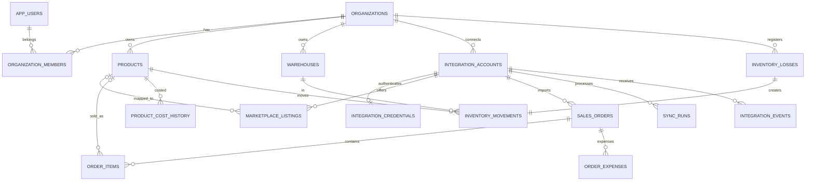

# 05 — Domínio e modelo relacional

## Princípio do modelo

Há 3 objetos que não devem ser confundidos:

1. **Produto interno** (`products`): SKU do seller, custo e identidade no próprio ERP.
2. **Anúncio externo** (`marketplace_listings`): vínculo opcional a um produto, por plataforma/variação/conta.
3. **Item vendido** (`order_items`): snapshot do título, preço e quantidade no momento da venda, com vínculo opcional ao produto interno.

Estoque interno tem histórico próprio (`inventory_movements`), não deriva simplesmente do saldo fornecido pelo marketplace.

## ER simplificado

## Entidades e responsabilidades

- `app_users`: perfil local vinculado ao provedor de autenticação; `auth_subject` único.
- `organizations`: tenant/empresa; moeda e fuso.
- `organization_members`: vínculo usuário–empresa; papéis.
- `integration_accounts`: conta de marketplace autorizada, provider, external seller id, status.
- `integration_credentials`: tokens cifrados, expiração e rotação (nunca enviá-los para o navegador).
- `products`: catálogo interno/SKU, custo atual para praticidade, status.
- `product_cost_history`: custo histórico com vigência e fonte.
- `marketplace_listings`: variação/anúncio externo; snapshots de preço e estoque externo (não físico).
- `sales_orders`: pedido marketplace ou manual, status, dinheiro, timestamps originais; unique por conta+ID externo.
- `order_items`: quantidade, preço, custo snapshotted opcional, ID de listing/variação.
- `order_expenses`: custo por pedido (comissão/frete/outro); indicar estimado ou confirmado e proveniência.
- `warehouses`: depósito físico ou lógico interno.
- `inventory_movements`: livro-razão de movimentações assinadas; saldo como soma por SKU/deposito.
- `inventory_losses`: classificação de perdas com motivo e custo snapshot, ligada a movimento negativo.
- `integration_events`: eventos externos recebidos para deduplicação e depuração, com política de retenção.
- `sync_runs`: execução de importação/checkpoints, erros e métricas.
- `audit_logs`: ações críticas de usuários.

## Relações e chaves relevantes

- SKU: `UNIQUE (organization_id, sku)`.
- Pedido externo: índice único parcial `(integration_account_id, external_order_id)` para importados.
- Itens externos: `UNIQUE (sales_order_id, external_line_key)` para linhas com chave estável.
- Listagens externas: uniqueness por conta+item+variação normalizada (`COALESCE` para variação nula).
- Evento externo: `UNIQUE (integration_account_id, event_key)`.
- Evento de estoque originado de integração: `UNIQUE (organization_id, idempotency_key)` quando presente.
- Perda `1:1` com movimento, evitando desconto duplicado.

## Observações operacionais

- O SQL de referência inclui chaves estrangeiras e checks, mas isolamento de `organization_id` nos relacionamentos cruzados exige **também** validação de tenant no service layer; considere FKs compostas/RLS em endurecimento futuro.
- Evitar valores financeiros em `float`; `NUMERIC(14,2)` e cálculos `Decimal`.
- Evitar DELETE físico em pedidos importados e movimentos de estoque.
- Valores de `status` normalizados podem coexistir com `raw_status` externo.
- Para custos incompletos, usar `NULL`, não `0`.
- Custos históricos não conhecidos = `NULL`, nunca inventar custo.
- Seeds fictícios devem ser explicitamente marcados como demonstração.
