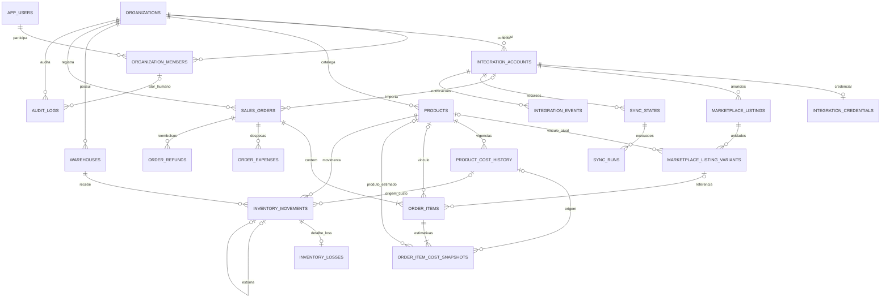

# 12 — Etapa 02A: revisão arquitetural e modelagem revisada

**Status: proposta para aprovação; não autoriza implementação.** Revisão iniciada em 04/11/2026 e concluída em 05/11/2026 (America/Sao_Paulo), baseada no commit `9f8223ebdb8a2ac52011a18e453f941d760416cb`. Branch: `feature/etapa-02-modelagem`.

Foram lidos integralmente AGENTS.md, README.md, docs/01 a docs/11 e database/001_initial.sql. Este documento consolida as decisões propostas e explicita divergências do blueprint; os documentos anteriores e o SQL permanecem como referência histórica. Nenhum SQL foi executado, nem schema Prisma, migration, seed, endpoint ou integração foi criado.

## 1. Resumo executivo

Recomenda-se PostgreSQL 17, modelo relacional com 21 tabelas e duas views conceituais. O domínio continua pequeno: catálogo, vendas, custos estimados, estoque manual, integrações de leitura e auditoria. Não entram contabilidade, contas a pagar/receber, compras completas, CRM, fiscal, kits, reservas, lotes ou FIFO.

As mudanças centrais são:

- Toda relação de domínio inclui organização na FK. RLS protege acesso e escrita; membership continua necessário para autorização.
- Produto/SKU, anúncio, unidade vendável externa e item vendido são distintos. Um anúncio sem variações tem uma unidade vendável base; qualquer unidade pode permanecer sem produto interno.
- Custos de aquisição têm vigência e revisões imutáveis. Custos usados nas vendas têm snapshots próprios versionados, sem copiar automaticamente novos custos para o passado.
- Pedidos manuais e importados compartilham o domínio, com origem explícita; o canal deriva da conta. Pagamento, logística, cancelamento e reembolso são dimensões separadas.
- Perda é um subtipo de movimento: quantidade, produto, depósito, ator e custo existem somente no ledger. Constraints diferidas garantem exatamente um detalhe de perda para cada movimento loss.
- Sincronização tem cursor durável, lease e geração; eventos persistidos funcionam como inbox recuperável. Redis não é a única fonte do trabalho pendente.

A modelagem admite os três providers, mas só Mercado Livre será integrado primeiro, somente leitura. Os exemplos Shopee são fictícios e não afirmam disponibilidade de API. Importar pedido nunca movimenta estoque, histórico ou recente, nesta versão.

## 2. Convenções do dicionário

Os campos descritos são a proposta completa para o MVP. `?` significa NULL permitido; sem `?`, NOT NULL. Campos agrupados na mesma célula têm o mesmo tipo. `U` = uuid; `T` = timestamptz; `S` = text; `J` = jsonb; `I` = integer; `B` = boolean; `C` = char(3); `D6` = numeric(20,6); `D2` = numeric(20,2). Estados são enums PostgreSQL enumerados na seção 5, não texto livre. JSON é objeto com allowlist e limite de tamanho, nunca depósito de payload bruto.

Nas constraints e índices, `org`, `account`, `product`, `order`, `item`, `listing`, `warehouse`, `history` e `reversal` abreviam os respectivos campos `organization_id`, `integration_account_id`, `product_id`, `sales_order_id`, `order_item_id`, `listing_id`, `warehouse_id`, `product_cost_history_id` e `reversal_of_id`; não são colunas adicionais. Defaults só existem quando explicitados; os demais campos obrigatórios são preenchidos pela operação.

**Campos comuns T0**: em todas as tabelas de tenant abaixo, salvo exceções expressas, `id U PK` (UUID gerado), `organization_id U FK organizations(id)`, `created_at T default now()`, `UNIQUE(organization_id,id)`. `organization_id` é imutável. Não há ON UPDATE CASCADE.

**Campos M**: `updated_at T default now()`, atualizado por trigger em toda alteração efetiva; não existe em registros append-only. **Campos A**: `actor_kind enum`, `actor_user_id U?`, `actor_system_code S?`, `correlation_id U`. Exatamente um ator: user exige user_id e system_code NULL; system exige user_id NULL e código permitido. FK de ator humano é `(organization_id,actor_user_id) -> organization_members(organization_id,user_id)`. Membro inativo permanece referenciável; autorização de nova operação exige membro ativo. Código de sistema não é informado livremente pelo cliente.

Quantidades são inteiras no MVP; saldo usa bigint na soma. Produtos fracionados exigem revisão antes de habilitar. Dinheiro não usa float: API futura transportará Decimal como string. Valores monetários e custos são não negativos e finitos, incluindo rejeição explícita de NaN/infinito. NULL é desconhecido; zero exige evidência de custo/valor zero. Nenhum valor financeiro tem default zero. `reversal_of_id` é obrigatório se e somente se movement_type=reversal; custo de reversão copia também basis e referência histórica do original. Moeda de catálogo/estoque é a da organização, inicialmente BRL, imutável após primeiro fato financeiro; outras moedas de pedido podem ser guardadas, mas não recebem custo BRL nem entram em agregação conjunta. Não há câmbio no MVP.

**FK padrão**: toda referência entre tabelas T0 usa `(organization_id,foreign_id) -> (organization_id,id)`, inclusive autorreferências e FKs opcionais. As exceções de PK e as FKs adicionais de mesma conta/pedido/produto estão explicitadas abaixo. Relação opcional usa MATCH SIMPLE com organização sempre obrigatória. Atributos de identidade externa são case-sensitive, não vazios; não converter IDs numéricos para Number nem remover zeros. Todos os DELETE/UPDATE de chaves usam RESTRICT/NO ACTION, salvo procedimentos de expurgo explicitamente separados da aplicação.

## 3. Dicionário de dados e responsabilidades

### 3.1 Identidade e empresas (3 tabelas)

| Tabela               | Campos e tipos                                                                                                              | Chaves, responsabilidade e regras                                                                                                                                                                              |
| -------------------- | --------------------------------------------------------------------------------------------------------------------------- | -------------------------------------------------------------------------------------------------------------------------------------------------------------------------------------------------------------- |
| app_users            | id U PK; auth_issuer S?; auth_subject S?; email S?; name S?; status enum; created_at T; updated_at T                        | Perfil global, sem senha. UNIQUE(auth_issuer,auth_subject); ambos presentes para active, ambos NULL para anonymized. Subject só é único dentro do issuer. Email opcional, não é chave de login. Atualização M. |
| organizations        | id U PK; name S; currency_code C default BRL; timezone S default America/Sao_Paulo; status enum; created_at T; updated_at T | Tenant; status active/suspended/pending_deletion. Validar timezone IANA e moeda suportada. Não contém CPF/CNPJ/endereço.                                                                                       |
| organization_members | organization_id U; user_id U; role enum; status enum; joined_at T; updated_at T                                             | PK(organization_id,user_id); FKs organizations e app_users. N:N usuário/organização. Sem T0. Manter tombstone inactive. Último owner ativo não pode ser removido de organização active.                        |

Papéis: owner administra organização, membros, contas e operação; admin administra operação e contas, não transfere propriedade nem exclui tenant; operator gerencia catálogo, vínculos, vendas manuais e estoque, sem credenciais/membros; viewer somente leitura sanitizada. Apenas owner aparece inicialmente na UI. Matriz fica no código de autorização, sem tabelas genéricas de permissões no MVP. Todos os papéis exigem membership ativo; roles do banco separam privilégios técnicos, não substituem esses papéis.

### 3.2 Contas, catálogo externo e processamento (6 tabelas)

| Tabela                       | Campos adicionais a T0                                                                                                                                                                                                                                        | Chaves, responsabilidade e regras                                                                                                                                                                                                                                                                                                                   |
| ---------------------------- | ------------------------------------------------------------------------------------------------------------------------------------------------------------------------------------------------------------------------------------------------------------- | --------------------------------------------------------------------------------------------------------------------------------------------------------------------------------------------------------------------------------------------------------------------------------------------------------------------------------------------------- |
| integration_accounts         | provider enum; external_account_scope S; external_seller_id S; display_name S?; connection_status enum; connected_at T; disconnected_at T?; M                                                                                                                 | UNIQUE(provider,external_account_scope,external_seller_id) global. Escopo é namespace canônico de identidade definido pelo adapter, não rótulo arbitrário. Reconexão reutiliza a conta. FK não transfere tenant.                                                                                                                                    |
| integration_credentials      | organization_id U; integration_account_id U PK; encrypted_bundle bytea; nonce bytea; auth_tag bytea; key_version S; algorithm S; access_expires_at T?; refreshed_at T?; credential_version I; refresh_lease_token U?; refresh_lease_until T?; created_at T; M | Exceção sem T0/id; FK composta à conta, UNIQUE(org,account). Envelope cifra access/refresh token e scopes; refresh token pode faltar dentro do envelope. Algorithm restrito a AES-256-GCM; nonce 12 bytes, tag 16 bytes; version > 0. Lease campos ambos NULL ou presentes. Acesso exclusivo do serviço de integração.                              |
| marketplace_listings         | integration_account_id U; external_item_id S; title S; raw_status S?; external_updated_at T?; synced_at T; archived_at T?; M                                                                                                                                  | Anúncio pai. UNIQUE(org,account,external_item_id); UNIQUE(org,account,id). FK conta. Não tem produto nem estoque físico.                                                                                                                                                                                                                            |
| marketplace_listing_variants | integration_account_id U; listing_id U; external_variant_id S?; product_id U?; external_sku S?; title S?; currency_code C?; current_price D6?; external_available_quantity I?; external_updated_at T?; synced_at T; archived_at T?; M                         | Unidade vendável. FK (org,account,listing) -> listings(org,account,id); FK conta e produto. UNIQUE(org,listing,external_variant_id) NULLS NOT DISTINCT; UNIQUE(org,account,id). NULL identifica a única unidade base, nunca string vazia. Quantidade externa desconhecida = NULL; negativa é rejeitada na normalização. Preço presente exige moeda. |
| sync_states                  | integration_account_id U; resource enum; cursor J?; watermark_at T?; generation bigint; lease_token U?; lease_until T?; last_success_at T?; next_attempt_at T?; M                                                                                             | UNIQUE(org,account,resource). Cursor durável por conta/recurso, geração >= 0, lease pareado. Resource orders/listings. Não contém tokens ou URLs assinadas. FK conta.                                                                                                                                                                               |
| sync_runs                    | sync_state_id U; kind enum; status enum; checkpoint J?; rows_upserted bigint default 0; attempt_count I default 0; generation bigint; lease_token U?; error_code S?; started_at T?; finished_at T?; M                                                         | FK sync_state. Registro de execução/tentativas, não fonte exclusiva do cursor. Recursos/conta derivados do estado. UNIQUE parcial(sync_state_id) WHERE status=running. Contadores >= 0. Terminal exige finished_at; running exige started_at e lease_token.                                                                                         |

A tabela de eventos está na seção 3.6 para manter sua função de inbox explícita. Total desta seção: seis tabelas; eventos completam a infraestrutura de integração.

Anúncio pode existir ainda sem unidades durante importação incompleta. Após leitura completa, terá uma base sem variações ou unidades com IDs externos. A troca de estrutura arquiva unidades antigas e cria as novas; não altera identidades nem remove referências de vendas. Não se permite unidade base ativa junto com variantes ativas: trigger serializa no anúncio e valida conjunto. Uma variante aponta a zero ou um produto, um produto a muitas variantes em contas distintas; kits/múltiplos produtos na mesma variante ficam fora do MVP. Mudança de vínculo afeta vendas futuras, nunca remapeia silenciosamente itens históricos.

### 3.3 Catálogo e custos (2 tabelas)

| Tabela               | Campos adicionais a T0                                                                             | Chaves, responsabilidade e regras                                                                                                                                                                                                                                  |
| -------------------- | -------------------------------------------------------------------------------------------------- | ------------------------------------------------------------------------------------------------------------------------------------------------------------------------------------------------------------------------------------------------------------------ |
| products             | sku S; name S; description S?; active B default true; M                                            | UNIQUE(org,sku). SKU normalizado como trim + maiúsculas ASCII, padrão `[A-Z0-9._-]+`, até 80 caracteres; sem reciclar SKU de produto inativo. Não contém current_unit_cost.                                                                                        |
| product_cost_history | product_id U; effective_at T; revision I; unit_cost D6?; currency_code C; source enum; reason S; A | Append-only. UNIQUE(org,product,effective_at,revision); UNIQUE(org,product,id). FK produto. Revision > 0; moedas compatíveis com organização. NULL pode marcar vigência de custo desconhecido. Fonte manual/purchase/import é proveniência, não módulo de compras. |

Custo vigente em instante t: filtrar effective_at <= t, ordenar effective_at DESC e revision DESC, tomar uma linha. Cada vigência vale até a próxima; para corrigir a mesma vigência, adicionar revision seguinte sob lock no produto. Não usar intervalos sobrepostos nem coluna duplicada de custo atual. Sem linha anterior ou com unit_cost NULL, custo desconhecido. Consulta conceitual `product_current_costs` usa a mesma regra em now(); custo futuro não vigora antecipadamente. Retroatividade só muda consultas futuras ao histórico, não snapshots já registrados.

### 3.4 Vendas e financeiro estimado (5 tabelas)

| Tabela                    | Campos adicionais a T0                                                                                                                                                                                                                                                                                                                                                                                                                                                                                                                                                | Chaves, responsabilidade e regras                                                                                                                                                                                                                                                                                                                                                                                     |
| ------------------------- | --------------------------------------------------------------------------------------------------------------------------------------------------------------------------------------------------------------------------------------------------------------------------------------------------------------------------------------------------------------------------------------------------------------------------------------------------------------------------------------------------------------------------------------------------------------------- | --------------------------------------------------------------------------------------------------------------------------------------------------------------------------------------------------------------------------------------------------------------------------------------------------------------------------------------------------------------------------------------------------------------------- |
| sales_orders              | integration_account_id U?; origin enum; external_order_id S?; manual_request_key S?; manual_request_hash S?; sold_at T; paid_at T?; cancelled_at T?; external_updated_at T?; last_fetched_at T?; payment_status enum; fulfillment_status enum; cancellation_status enum; refund_status enum; raw_statuses J?; currency_code C; items_gross_amount D2?; discount_amount D2?; buyer_shipping_amount D2?; order_total_amount D2?; expenses_complete B default false; refunds_complete B default false; source_revision S?; normalized_hash S?; version I default 1; A; M | FK conta opcional. UNIQUE(org,account,external_order_id) para imported; UNIQUE(org,manual_request_key) para manual; UNIQUE(org,id,account). Source provider derivado da conta. Origin manual exige conta/external NULL e manual_request_key/manual_request_hash presentes; imported exige conta/external e ambos os campos manuais NULL. sold_at obrigatório, nunca usar data de importação como fallback silencioso. |
| order_items               | sales_order_id U; integration_account_id U?; listing_variant_id U?; product_id U?; line_key S; external_item_id S?; external_variant_id S?; seller_sku_snapshot S?; title_snapshot S; quantity I; unit_price D6?; line_gross_amount D2?; line_discount_amount D2?; captured_at T; M                                                                                                                                                                                                                                                                                   | FK pedido sempre (org,order); FK adicional (org,order,account) -> orders(org,id,account). FK (org,account,variant) -> variants(org,account,id); FK produto. UNIQUE(org,order,line_key). Quantity > 0. Trigger exige conta igual à do pedido, inclusive NULL; variant exige conta. Produto/variante opcionais, custo não depende de haver anúncio importado.                                                           |
| order_item_cost_snapshots | order_item_id U; product_id U?; product_cost_history_id U?; revision I; quantity_snapshot I; unit_cost_snapshot D6?; currency_code C; basis enum; reason S; A                                                                                                                                                                                                                                                                                                                                                                                                         | Append-only, FK item e produto; FK (org,product,history) -> cost_history(org,product,id). UNIQUE(org,item,revision). Quantity > 0 e revision > 0. Cost source exige history/product e mesmo valor/moeda da linha histórica; unknown exige custo/history NULL; override/imported exige custo conhecido, history NULL. Snapshot inclui produto e quantidade usados, mesmo em revisão posterior.                         |
| order_expenses            | sales_order_id U; category enum; entry_key S; amount D2?; basis enum; source enum; external_reference S?; reason S?; A; M                                                                                                                                                                                                                                                                                                                                                                                                                                             | FK pedido. UNIQUE(org,order,entry_key). Moeda herdada do pedido. Basis unknown exige amount NULL, estimated/confirmed exige amount presente. Source manual/imported; imported só em pedido imported. category marketplace_fee/seller_shipping/tax/advertising/packaging/other. Correções auditadas; identidade imutável.                                                                                              |
| order_refunds             | sales_order_id U; entry_key S; external_reference S?; status enum; amount D2?; occurred_at T?; source enum; A; M                                                                                                                                                                                                                                                                                                                                                                                                                                                      | FK pedido. UNIQUE(org,order,entry_key). Moeda herdada. Source manual/imported coerente com pedido. Reembolso agregado por ocorrência, sem presumir retorno físico. Amount conhecido quando succeeded; demais estados podem ter NULL. Correções de fonte auditadas.                                                                                                                                                    |

As cinco tabelas acima incluem a nova tabela de snapshots; reembolsos tornam explícitas múltiplas ocorrências parciais. Não se cria pagamento bancário, saldo financeiro ou recebível. Cada item recebe revision 1 de custo, mesmo desconhecido, no mesmo commit: trigger diferida exige pelo menos um snapshot por item e valida quantidade/produto do snapshot inicial. Revisões posteriores são explícitas e auditadas; a maior revision é a estimativa vigente, anteriores permanecem consultáveis. Não há current_snapshot_id redundante. Toda nova revisão valida produto/quantidade contra o item no instante da criação e moeda contra o pedido, sob lock; um produto histórico pode divergir do vínculo atual após correção explícita. History só é permitido para basis=product_cost_at_sale, com custo conhecido; custo desconhecido usa basis=unknown mesmo se a vigência consultada contém NULL.

`line_key` é identidade estável produzida pelo adapter, não posição no array. Preferir ID de linha do provedor. Se não existir, agrupar deterministicamente linhas economicamente idênticas por anúncio, variante, preço e desconto, somando quantidades, e versionar a regra do adapter. Mudança que não possa ser reconciliada sem ambiguidade interrompe a atualização e exige revisão; nunca anexar linhas arbitrárias. Manual usa UUID de linha imutável em texto.

Preço, título, SKU e quantidade são snapshots comerciais: não mudam com catálogo ou anúncio. Divergência real da fonte exige operação de correção com lock do pedido e auditoria de valores anteriores/novos; sem DELETE de itens. Correção que altera composição não é um upsert cego: requer reconciliação explícita e novo snapshot de custo quando aprovado. O MVP não implementa pedidos rascunho: ao commit exige pelo menos um item, via trigger diferida. Payload incompleto fica pendente na inbox/sync, não fabrica pedido financeiro.

### 3.5 Estoque e perdas (3 tabelas)

| Tabela              | Campos adicionais a T0                                                                                                                                                                                                                     | Chaves, responsabilidade e regras                                                                                                                                                                                                                                                                                                                                                 |
| ------------------- | ------------------------------------------------------------------------------------------------------------------------------------------------------------------------------------------------------------------------------------------ | --------------------------------------------------------------------------------------------------------------------------------------------------------------------------------------------------------------------------------------------------------------------------------------------------------------------------------------------------------------------------------- |
| warehouses          | name S; active B default true; M                                                                                                                                                                                                           | UNIQUE(org,name). Depósito interno; um depósito padrão pode ser criado no onboarding futuro.                                                                                                                                                                                                                                                                                      |
| inventory_movements | warehouse_id U; product_id U; movement_type enum; quantity_delta I; unit_cost_snapshot D6?; product_cost_history_id U?; cost_basis enum; currency_code C; reversal_of_id U?; idempotency_key S; request_hash S; reason S; occurred_at T; A | FKs depósito, produto, reversal e (org,product,history). Append-only. UNIQUE(org,idempotency_key); UNIQUE(org,reversal_of_id) quando presente. Quantidade não zero; loss/sale negativos; opening/purchase/return positivos; adjustment assinado; reversal exato oposto. Custo da fonte history deve coincidir; unknown exige NULL; override exige custo conhecido e history NULL. |
| inventory_losses    | organization_id U; inventory_movement_id U PK; reason enum; description S?; created_at T                                                                                                                                                   | Exceção sem T0/id/A: FK (org,movement) -> movements(org,id), UNIQUE(org,movement). Subtipo append-only, reason damaged/lost/expired/inventory_discrepancy/other. Produto, depósito, ator, ocorrido_em, quantidade e custo são derivados do movimento.                                                                                                                             |

`inventory_balances` é view conceitual: soma quantity_delta por (org,warehouse,product), resultado bigint; não uma tabela de saldo editável. Não se cria posição de estoque/custo médio. Relatório de perdas deriva quantidade = -quantity_delta e valor = round(quantidade * unit_cost_snapshot,2); NULL continua NULL. Movimento loss exige exatamente uma linha de detalhe ao commit, e todo detalhe exige movimento loss negativo. A cardinalidade condicionada é assegurada por trigger de constraint diferida nos dois lados; FK/PK sozinhas não garantem existência inversa.

Estornar perda cria movimento reversal positivo com reversal_of_id apontando à saída, sem segundo detalhe de perda. Relatório mantém perda bruta e estorno separadamente, permitindo total líquido e eventos por data. Estorno só pode referenciar movimento original, nunca outro reversal; um original tem no máximo um estorno completo. Produto, depósito, moeda, custo (comparação NULL-safe) e módulo da quantidade devem ser idênticos; nenhuma revisão altera o original. Correção parcial usa estorno completo e novo movimento/perda na mesma transação.

Propõe-se permitir saldo negativo com alerta, pois o ledger inicial é informado manualmente e pode estar incompleto. Isso não elimina serialização: operação de ajuste absoluto calcula delta a partir do saldo sob lock; movimentos concorrentes precisam participar do mesmo protocolo. Reserva de estoque e proibição de saldo negativo não fazem parte do MVP proposto; dependem de aprovação A06.

### 3.6 Inbox e auditoria (2 tabelas)

| Tabela             | Campos adicionais a T0                                                                                                                                                                                                                               | Chaves, responsabilidade e regras                                                                                                                                                                                                                                                                 |
| ------------------ | ---------------------------------------------------------------------------------------------------------------------------------------------------------------------------------------------------------------------------------------------------- | ------------------------------------------------------------------------------------------------------------------------------------------------------------------------------------------------------------------------------------------------------------------------------------------------- |
| integration_events | integration_account_id U; event_key S; topic S; resource_id S; external_sent_at T?; payload_minimal J?; status enum; attempt_count I default 0; next_attempt_at T?; lease_token U?; lease_until T?; received_at T; processed_at T?; error_code S?; M | FK conta. UNIQUE(org,account,event_key). Inbox durável e recuperável; topic/resource_id permitidos pelo adapter; nunca URL arbitrária executável. Lease pareado e obrigatório em processing. Processed exige processed_at.                                                                        |
| audit_logs         | action S; entity_type S; entity_id U; details_minimal J; A                                                                                                                                                                                           | Append-only. Tipos/ações de catálogo controlado; referência polimórfica informativa, deliberadamente sem FK para sobreviver à anonimização/expurgo. Não serve de relacionamento de negócio. JSON só valores permitidos, IDs, razões, revisões e diffs numéricos; sem tokens, e-mails ou payloads. |

**Inventário total: 21 tabelas**, conforme dicionário (3 + 6 + 2 + 5 + 3 + 2), e duas views. O acréscimo líquido sobre as 17 tabelas iniciais é de quatro: variants, snapshots de custo, refunds e sync_states.

## 4. Diagrama ER

O diagrama mostra as 21 tabelas e cardinalidades principais. As FKs usam organização mesmo onde a aresta é abreviada. As arestas de ator em todas as tabelas A e as relações de ownership em todas as T0 são omitidas para legibilidade, permanecendo obrigatórias no dicionário. `INVENTORY_LOSSES` é 0..1 para movimentos gerais e exatamente 1 para o subtipo loss.

## 5. Estados, enums e transições

| Campo/família               | Valores propostos e semântica                                                           |
| --------------------------- | --------------------------------------------------------------------------------------- |
| app_users.status            | active, disabled, anonymized                                                            |
| organizations.status        | active, suspended, pending_deletion                                                     |
| member.role / status        | owner, admin, operator, viewer / active, inactive                                       |
| provider                    | mercado_livre, shopee, tiktok_shop                                                      |
| connection_status           | pending, connected, expired, needs_reauth, error, disconnected                          |
| actor_kind                  | user, system; códigos system: sync_worker, maintenance, bootstrap                       |
| origin                      | manual, imported; canal manual ou provider derivado                                     |
| payment_status              | unknown, pending, partially_paid, paid, failed; reembolso não apaga pagamento histórico |
| fulfillment_status          | unknown, unfulfilled, processing, shipped, delivered, returned, not_applicable          |
| cancellation_status         | unknown, none, requested, cancelled                                                     |
| sales_orders.refund_status  | unknown, none, partial, full; projeção do total de refunds confirmados quando completo  |
| order_refunds.status        | pending, succeeded, failed, cancelled                                                   |
| product_cost_history.source | manual, purchase, import                                                                |
| snapshot.basis              | unknown, product_cost_at_sale, manual_override, imported                                |
| inventory cost_basis        | unknown, product_cost_at_event, manual_override                                         |
| expense.basis / source      | unknown, estimated, confirmed / manual, imported                                        |
| expense.category            | marketplace_fee, seller_shipping, tax, advertising, packaging, other                    |
| movement_type               | opening, purchase, sale, return, loss, adjustment, reversal                             |
| loss.reason                 | damaged, lost, expired, inventory_discrepancy, other                                    |
| sync resource / kind        | orders, listings / initial, incremental, manual, webhook_recovery                       |
| sync status                 | queued, running, retry_wait, succeeded, failed, cancelled                               |
| event status                | received, processing, retry_wait, processed, dead_letter                                |

Estado desconhecido é explicitamente unknown, nunca paid/none por omissão. Transições externas não formam uma ordem numérica: delivered não deve voltar a shipped por evento antigo, mas uma correção oficial pode alterar estados. Adapter compara revisão externa e usa leitura atual; empate com conteúdo divergente exige nova consulta ou revisão. Pedido manual só muda por ação autorizada/auditada. Pagamento paid exige paid_at; cancelled exige cancelled_at; igualdade inversa não é presumida porque histórico pode preservar essas datas.

Runs: queued -> running -> succeeded/failed/cancelled/retry_wait; retry_wait -> running, com nova lease. Eventos: received/retry_wait -> processing -> processed/retry_wait/dead_letter. Lease vencida torna trabalho recuperável; dead_letter exige ação explícita para reabrir. Cada tentativa aumenta contador. Conta desconectada não autoriza novos jobs nem mantém tokens. Consistência entre conta connected e credencial existente será verificada por trigger diferida; pending/needs_reauth/disconnected podem não ter credencial.

## 6. Integridade e isolamento

### 6.1 Tenant, conta e autorização

FK composta é obrigatória já na Etapa 02B: movimento com organization A e product B falha no PostgreSQL, mesmo que inserido fora do ORM. PK UUID global facilita referências, mas não substitui UNIQUE(org,id). Pertencer ao mesmo tenant não basta para relacionar item de uma conta a anúncio de outra: FKs adicionais de conta na seção 3.4 impedem essa mistura. Trigger cobre igualdade com conta NULL que MATCH SIMPLE sozinho não garantiria.

RLS será ENABLE + FORCE em todas as tabelas de tenant e organizations. Policies usam contexto transacional definido pelo backend após validar identidade/membership, com USING e WITH CHECK; sem contexto, negar acesso. O papel runtime não é dono, superuser ou BYPASSRLS e não pode TRUNCATE, alterar policy ou desabilitar triggers. app_users tem política própria para perfil do sujeito autenticado, sem enumeração global; membership tem leitura limitada ao próprio usuário e operações administrativas mediadas. Bootstrap de tenant/membro usa caminho privilegiado mínimo e transacional, sem entregar credencial administrativa à aplicação geral.

Usar contexto local à transação, nunca configuração persistente na conexão do pool. Worker atua com tenant obtido de registro de conta validado, também sob RLS; descoberta global de trabalhos usa função/role restrito que retorna só identificadores de trabalho. Credenciais não recebem SELECT do papel comum da API. RLS por variável de sessão não autentica o portador de credenciais do banco: backend e segredos de conexão são fronteira de confiança; não expor banco ao cliente. FKs protegem relações independentemente dessa confiança. Erros de constraints são traduzidos sem revelar existência de registros de outro tenant.

A documentação do PostgreSQL distingue constraints relacionais de políticas por linha e os privilégios que contornam RLS. Ver [constraints PostgreSQL 17](https://www.postgresql.org/docs/17/ddl-constraints.html) e [RLS PostgreSQL 17](https://www.postgresql.org/docs/17/ddl-rowsecurity.html). As escolhas de tenant/contexto acima são decisões do SellerOS.

### 6.2 Índices recomendados

PKs e UNIQUE do dicionário já criam índices; não duplicá-los. Os índices de leitura de domínio começam com organization_id; a descoberta de memberships por usuário é a exceção global explicitada abaixo. Além deles:

| Tabela                         | Índice/finalidade                                                                                                               |
| ------------------------------ | ------------------------------------------------------------------------------------------------------------------------------- |
| organization_members           | (user_id,status,organization_id), descoberta de empresas do usuário                                                             |
| marketplace_listings           | (org,account,external_updated_at), incremental                                                                                  |
| marketplace_listing_variants   | (org,product_id); (org,listing_id); parcial (org,id) WHERE product_id IS NULL AND archived_at IS NULL                           |
| product_cost_history           | (org,product,effective_at DESC,revision DESC), busca temporal                                                                   |
| sales_orders                   | (org,sold_at DESC,id); (org,account,sold_at DESC,id); (org,payment_status,cancellation_status,sold_at DESC), filtros principais |
| order_items                    | (org,product_id); (org,account,listing_variant_id); UNIQUE org/order/line_key cobre leitura dos itens por pedido                |
| order_item_cost_snapshots      | UNIQUE org/item/revision atende busca reversa; (org,product,product_cost_history_id) apoia FK                                   |
| order_expenses / order_refunds | UNIQUE org/order/entry_key atende consulta por pedido                                                                           |
| inventory_movements            | (org,warehouse,product); (org,occurred_at DESC,id); (org,product,product_cost_history_id)                                       |
| sync_runs                      | (org,sync_state_id,created_at DESC); parcial de running descrito no dicionário                                                  |
| integration_events             | (org,status,next_attempt_at,received_at,id), retomada; (org,account,received_at DESC)                                           |
| audit_logs                     | (org,created_at DESC,id); (org,entity_type,entity_id,created_at DESC)                                                           |

Adicionar índice para cada FK não coberta por prefixo existente na implementação (incluindo atores e parent IDs); avaliar custo de escrita. Sem índices GIN em JSON nem particionamento prematuro. Validar planos com volume representativo na 02B; os índices de dashboard são candidatos, não promessa de performance.

### 6.3 Complementos SQL ao Prisma (somente especificação)

As migrations futuras serão a única trilha executável. Schema Prisma descreve tabelas, enums, tipos nativos, FKs compostas e uniques representáveis. SQL customizado na mesma migration deverá conter:

1. CHECKs de origem, nulabilidade pareada, sinais, finitude, custos, atores, timestamps/estados e identidade não vazia.
2. UNIQUE NULLS NOT DISTINCT das variantes e índices condicionais que a versão adotada do Prisma não representar. Não usar COALESCE com sentinela que colida com ID real.
3. RLS, policies, roles/grants e funções de contexto/descoberta restritas; ambas as views com segurança do invocador para não contornar RLS.
4. Triggers de updated_at; bloqueio de UPDATE/DELETE nos fatos imutáveis e bloqueio de mudanças em identidade/organization_id.
5. Constraint triggers diferidas para perda/movimento nos dois sentidos; pedidos com itens; itens com snapshot; conta conectada com credencial; igualdade NULL-safe nos estornos/custos e coerência de conta do item.
6. Triggers de serialização/validação para estornos, snapshots, variante base versus variantes, moeda e último owner. Triggers agregadas tomam lock no pai antes de verificar o conjunto, prevenindo write skew.
7. Views inventory_balances e product_current_costs; rotinas transacionais restritas para ledger, revisão de custo e expurgo.

CHECK não deve consultar outra tabela. Relações cross-row usam FK, trigger ou rotina com privilégios restritos. Transação no serviço sozinha não protege escrita direta; runtime não terá DML irrestrito em ledger/custos/auditoria. Triggers bloqueiam mutação mesmo se um caminho acidental de ORM tentar fazê-la. Roles de migração/manutenção são separadas.

A [documentação oficial de Prisma Migrate](https://www.prisma.io/docs/orm/v7/prisma-migrate/workflows/unsupported-database-features) orienta personalizar migrations para triggers e views; ela já documenta suporte a índices parciais em versões atuais. A versão do projeto ainda será escolhida: não assumir que todo índice especial é ou não suportado. Na 02B, testar introspecção/diff e preservar SQL customizado. Nunca executar database/001_initial.sql em paralelo, nem usar db push como trilha de produção.

## 7. Operações transacionais

### 7.1 Criação de organização e membership

Validar sujeito autenticado; em transação criar tenant e owner ativo, gravar auditoria com esse membro e confirmar. Alterar/remover owner exige lock da organização e verificar que resta owner ativo. Membros são desativados, não apagados; ator histórico continua válido. Suspensão do tenant bloqueia novas operações de domínio.

### 7.2 Alterar custo e reestimar venda

Lock no produto; verificar moeda; selecionar próxima revision da vigência; inserir custo e audit_log no mesmo commit. O custo atual deriva do histórico. Reestimar venda é outra operação: lock no pedido e item, motivo obrigatório, escolher custo vigente em sold_at (ou override explícito), inserir revision seguinte do snapshot e auditoria. Uma nova importação não executa esse caminho. Item previamente não vinculado pode receber vínculo explícito e snapshot posterior; histórico mantém produto/quantidade/valor de cada revisão.

### 7.3 Registrar perda, estornar e ajustar

Em uma transação: validar membership/tenant; tomar lock de estoque por produto (SELECT FOR UPDATE no produto é a escolha simples do MVP, serializando todos os depósitos desse SKU); buscar idempotency_key; se já existe comparar request_hash canônico. Mesma chave e conteúdo devolvem movimento existente; conteúdo diferente é conflito. Selecionar custo no occurred_at; inserir loss negativo, detalhe de perda e auditoria. Constraints diferidas são avaliadas no commit; erro em qualquer passo desfaz tudo. Retry depois de timeout não cria segunda saída.

Todas as escritas de estoque, inclusive entradas, estornos e ajustes, passam por rotina que toma o mesmo lock; triggers garantem protocolo para INSERT permitido. Para vários produtos, ordenar UUIDs ao adquirir locks. Estorno também bloqueia original, valida inexistência de estorno e cria inverso com custo idêntico. Ajuste de saldo absoluto calcula delta sob lock; delta zero não gera movimento. Erros de deadlock/serialização podem ser repetidos com backoff limitado e mesma chave. Não manter transação aberta durante chamada de rede. O request_hash inclui tipo, produto, depósito, quantidade, data explícita, motivo/detalhe de perda e override fornecido; não inclui custo derivado novamente do cadastro. Assim, retry após mudança de custo devolve o fato original. Para ajuste delta zero, não há efeito para duplicar; o contrato retorna no-op, sem promessa de persistir essa resposta.

Venda manual usa manual_request_key e hash canônico imutável do pedido inicial (incluindo itens); criação concorrente resolve por UNIQUE. Retry compara o hash original, não os campos atuais já editados. Mesma chave com outro conteúdo é conflito. Alterações posteriores usam version para controle otimista e auditoria.

### 7.4 Importar/reimportar pedido

Consultar API fora da transação com lease de sync. Normalizar identidade, datas, valores e linhas; incompletude estrutural falha de maneira recuperável. Iniciar transação com contexto de organização; adquirir lock por conta/recurso (MVP) e verificar generation/lease; upsert pela UNIQUE externa, lock no pedido existente. Comparar revisão externa e hash canônico, não timestamp local de chegada.

Na primeira inserção criar pedido, itens, snapshot de custo revision 1, despesas/reembolsos conhecidos e auditoria em um commit. Custo busca vigência em sold_at e moeda compatível; se não houver, unknown. Repetição idêntica é no-op de negócio; metadados de sync podem avançar. Atualização nova altera estados/fatos externos autorizados e registra diff mínimo, preservando snapshots. Resposta sem algum campo não apaga valor anterior; limpeza exige evidência explícita. Correção comercial ambígua segue fluxo da seção 3.4.

Sem revisão externa confiável, serializar fetch por conta/recurso via lease e fencing; obter novo estado após adquirir lease, nunca aplicar resposta de trabalhador com geração antiga. Se a API puder retornar estado antigo sem versão, garantia de ordem absoluta é impossível: manter reconciliação periódica e sinalizar divergência, sem inventar monotonicidade. Nenhuma escrita de estoque ocorre nesta transação.

### 7.5 Sync, inbox, retry e credenciais

Gravar evento com chave única antes de reconhecer recebimento. Se provider não fornece ID de evento, gerar UUID por recebimento; duplicação de notificações é aceitável porque o recurso é idempotente. Não usar só topic/resource como chave permanente, pois suprimiria atualizações legítimas. Hash de envelope só é alternativa após comprovar campos de identidade/versionamento no adapter.

Worker busca received/retry_wait e leases vencidas. Claim transacional atribui token/expiração e tentativa; processo morto não perde trabalho. Consumidor consulta recurso atual. Commit dos dados e marcação processed ocorrem juntos quando cabível; se houver páginas, cada página é idempotente e cursor avança somente junto ao commit da página. Envio ao Redis após commit pode falhar: scanner periódico da inbox/sync_states recoloca trabalho pendente, fechando a lacuna sem tabela outbox adicional no MVP. Não depender de atomicidade PostgreSQL–Redis.

Ao recuperar lease vencida, encerrar a execução running antiga antes de iniciar outra, no mesmo commit; isso libera a unicidade parcial. sync_states serializa por conta/recurso e incrementa generation; somente detentor de token/generation atual pode renovar lease, persistir página/cursor e concluir run. Retry do mesmo checkpoint não duplica dados. 401/429 e erros permanentes são códigos normalizados e políticas futuras do adapter, sem armazenar erro bruto.

Refresh de token usa lease exclusiva na credencial e compare-and-swap de credential_version; nenhuma transação longa durante HTTP. Persistir novo envelope/version e liberar lease atomicamente. Crash depois de consumir refresh token e antes de salvar pode exigir reconexão; não existe exatamente uma vez garantido contra API externa. Disconnect cancela leases/jobs e remove envelope em operação auditada, preservando conta/identidades para reconectar.

## 8. Dinheiro, indicadores e preservação histórica

Precisão: D6 nos custos e preços unitários; D2 nos totais monetários finais. Multiplicar em Decimal com precisão suficiente e arredondar uma vez por linha para duas casas, half-up para valores não negativos. COGS soma totais de linhas arredondados; não arredondar custo unitário para duas casas antes da multiplicação. Nunca reduzir silenciosamente valor de provider que não caiba no tipo: rejeitar e revisar contrato.

items_gross_amount é bruto dos produtos; discount_amount é desconto aplicado a esses produtos; buyer_shipping_amount é frete cobrado do comprador; order_total_amount é total normalizado = bruto - desconto + frete. Quando todos forem conhecidos, essa identidade deve fechar; descontos não excedem bruto no modelo proposto. Encargos externos sem mapeamento impedem afirmar essa identidade e mantêm campos derivados desconhecidos/revisão pendente. Guardar unit_price e total da linha separadamente para não forçar distribuição inexata de descontos. Frete do vendedor é despesa distinta, não confundir com frete pago pelo comprador. Zero frete/taxa só quando confirmado.

Período padrão usa sold_at, inclusive manuais, com intervalo [início,fim) convertido do fuso para UTC. Estado financeiro é o atual conhecido: alterações tardias podem revisar métricas de uma coorte passada, mas não o custo capturado. Um relatório histórico "como era conhecido naquela data" é evolução futura, não prometido pelo MVP. Eventos de perda usam occurred_at; reembolsos também podem ser listados por occurred_at, porém margem por coorte usa sold_at do pedido.

Elegíveis: payment_status=paid, cancellation_status=none. unknown/requested/cancelled ficam fora do subtotal confirmado e têm contagem/valor separado. Receita operacional conhecida = order_total_amount - soma refunds succeeded, apenas quando refunds_complete=true; isso não é repasse bancário. Se refunds_complete=false, mostrar receita anterior a reembolsos e lacuna, sem tratar lista vazia como zero. Total refund acima do pedido ou classificação incompatível vai para revisão; lock do pedido serializa a validação agregada. Escritas em refunds e nos totais/completude do pedido recalculam a projeção sob lock e trigger; succeeded exige occurred_at. Refund none/partial/full é calculado do agregado completo e total conhecido, caso contrário unknown.

Reembolso reduz receita, mas não devolve automaticamente COGS nem estoque: o item pode ter sido perdido, e não há confirmação de retorno vendável. Para devolução física, operador lança return separado; mudar custo de venda exige revisão explícita. Esta política conservadora precisa de aprovação. Cancelamento exclui todo pedido elegível mesmo que refunds ainda não estejam completos; não somar a mesma dedução novamente.

Margem estimada em valor = receita operacional conhecida - COGS snapshot conhecido - despesas conhecidas. Se falta qualquer componente, apresentar subtotal parcial, cobertura e motivos; margem completa fica NULL. Percentual exige receita positiva, senão NULL. Cobertura de custo = soma de quantidades elegíveis com snapshot conhecido / soma de quantidades elegíveis, além de contagem de pedidos/itens sem vínculo. Não reportar 100% sobre somente os itens mapeados. expenses_complete só pode ser true por avaliação explícita de categorias aplicáveis e fontes; estimated continua rotulado estimado. Perdas não são somadas novamente ao COGS das vendas; mostrar separadas. Agregar por moeda, nunca combinar BRL e USD.

## 9. Exemplos fictícios — Demonstração

IDs curtos abaixo são apelidos legíveis de UUIDs; nenhum representa conta real.

1. **SKU em dois marketplaces.** Organização Alfa, produto P1 sku CANECA-AZUL. Conta ML1/mercado_livre tem anúncio MLB-DEMO-10, variante AZUL; conta SH1/shopee tem anúncio SH-DEMO-80, unidade base external_variant_id=NULL. As duas unidades apontam a P1. Outro anúncio ML importado com variante V9 e product_id=NULL permanece visível como não vinculado. Não se cria produto automático pelo título/external_sku.
2. **Venda importada com vários itens.** Pedido O1 de ML1, external_order_id=DEMO-900, sold_at=2026-11-01T13:00:00Z, paid/processing/none/none, BRL. L1 vende 2 P1 a 30,00 (bruto 60,00); L2 vende 1 P2 a 20,00. Pedido bruto 80,00, desconto 5,00, frete comprador 10,00, total 85,00. Custos unitários 10,125000 e 8,000000: COGS 20,25 + 8,00 = 28,25. Despesas confirmadas 8,00 comissão e 12,00 frete vendedor; com despesas/reembolsos completos, receita 85,00 e margem estimada 36,75. O ledger não recebe linhas.
3. **Custo novo preserva venda.** P1 tinha H1 efetivo em 01/10, custo 10,125000. Cadastro H2 efetivo em 03/11 por 12,750000 faz venda de 04/11 usar H2. O snapshot de O1 continua H1 e 20,25 de COGS. Correção retroativa em H1 cria revision 2 do histórico, não altera O1; reestimar O1 exige nova revisão do snapshot com ator e motivo.
4. **Perda.** Depósito D1 tinha +10 P1. Chave loss:DEMO-7 cria movimento M7 loss -2 a 12,750000 e detalhe damaged no mesmo commit: saldo 8, perda 25,50. Repetir chave e mesmo request_hash devolve M7. Falhar o detalhe desfaz a saída. Estorno M8 referencia M7 e soma +2 a mesmo custo: saldo 10, perda bruta 25,50 e reversão 25,50. Não se edita M7.
5. **Reimportação.** Dois workers recebem DEMO-900. Lease serializa aplicação e UNIQUE(org,ML1,DEMO-900) garante um O1; UNIQUE(order,line_key) mantém L1/L2. Repetição idêntica preserva IDs, despesas e snapshots. Evento novo com shipped atualiza logística, sem rebaixar paid nem criar estoque. Reuso de chave manual/movimento com conteúdo diferente retorna conflito, não sucesso falso.
6. **Relação entre empresas.** Alfa tenta inserir movimento com org=Alfa, product=P-Beta e warehouse=D1-Alfa. FK(org,product) não encontra (Alfa,P-Beta) e aborta, mesmo sem Prisma. Tentar item Alfa ligado a listing de Beta também falha; listing de outra conta da própria Alfa falha pela FK org/conta/variante. SELECT sem contexto RLS retorna nada e INSERT é recusado.

## 10. Privacidade, retenção e credenciais

Proposta técnica, não definição de prazo legal. Não há necessidade no MVP de nome/endereço/telefone/documento do comprador, dados de cartão, mensagens ou endereço de entrega. Guardar somente IDs de vendedor/pedido/anúncio necessários à reconciliação, timestamps, títulos de produto e valores normalizados. Evitar títulos/notas contendo PII; limitar notas livres e avisar sobre dados pessoais. Email/nome de app_users são opcionais e removíveis; autenticação usa issuer/subject.

Credenciais: criptografia autenticada de envelope, chave fora do PostgreSQL e do repositório, arquivo protegido/secret de ambiente no desenvolvimento sem serviço pago. AAD inclui organização, conta e versão do formato para impedir troca de envelope. key_version permite rotação: decifrar com chave antiga, cifrar com nova, atualizar via CAS; manter chave antiga só até confirmar rotação/recuperação de backups conforme política. Nonce nunca reutilizado com mesma chave. Tokens nunca em auditoria, JSON público, logs ou front. Não persistir códigos OAuth; state/PKCE ficam em armazenamento efêmero com TTL no futuro fluxo de autenticação.

| Classe                                      | Retenção proposta e ação                                                                                                                                                               |
| ------------------------------------------- | -------------------------------------------------------------------------------------------------------------------------------------------------------------------------------------- |
| Tokens                                      | Excluir ao desconectar/revogar; substituir envelope ao renovar; backup cifrado com acesso restrito e expiração aprovada                                                                |
| payload_minimal de eventos                  | Até 7 dias para diagnóstico, depois NULL; somente allowlist sem PII/segredo                                                                                                            |
| Metadados/event_key de inbox                | 90 dias após terminal; pending/dead_letter precisa de resolução antes de expurgo; replay posterior continua seguro por identidade do recurso                                           |
| sync_runs                                   | 90 dias após término; cursor vigente permanece em sync_states; auditoria de falhas críticas mínima                                                                                     |
| Perfil pessoal                              | Ao excluir usuário, desativar memberships e anonimizar email/name/issuer/subject; UUID tombstone preserva referências. Transferir último owner antes                                   |
| Pedidos, custos, ledger, perdas e auditoria | Sem expurgo automático no MVP; retenção durante contrato. Antes de produção, aprovar matriz por finalidade/obrigação e prazo de encerramento, evitando retenção indefinida por omissão |
| Tenant encerrado                            | Suspender, revogar tokens, oferecer exportação e aplicar expurgo controlado após prazo aprovado; incluir backups e retenções justificadas                                              |

Append-only vale para papéis operacionais. Limpeza de payload, anonimização e expurgo usam papel de manutenção separado, escopo limitado e registro da ação sem copiar PII. Não desabilitar triggers como rotina operacional. A referência audit_logs.entity_id é informativa e não impede exclusão legalmente devida. A política final de retenção depende de aprovação responsável, obrigações aplicáveis e termos de cada plataforma; não estabelecer aqui prazos legais inventados.

## 11. Comparação com SQL inicial e dez pendências

| Pendência de docs/10       | Alteração proposta e justificativa                                                                                                                   |
| -------------------------- | ---------------------------------------------------------------------------------------------------------------------------------------------------- |
| 1. Tenant                  | org em credenciais/sync/eventos, UNIQUE(org,id), FKs compostas em todos os relacionamentos, RLS já na 02B; backend deixa de ser única barreira       |
| 2. Perda/movimento         | Loss compartilha identidade com movimento e não duplica quantidade/custo; constraint trigger garante existência inversa e subtipo; estorno explícito |
| 3. Ledger/auditoria        | Ator humano ou sistema obrigatório; membership preservado; bloqueio DML/imutabilidade; idempotência obrigatória e request_hash                       |
| 4. Pedido/canal            | origin manual/imported, provider derivado; quatro dimensões de status; refunds separados e regra de elegibilidade explícita                          |
| 5. Datas/dinheiro          | sold_at obrigatório, timestamps UTC, D6 unitário/D2 total; financeiro sem defaults zero e completude explícita                                       |
| 6. Custos                  | Remover current_unit_cost, histórico revisionado com NULL permitido e snapshots versionados; nenhuma alteração automática de vendas antigas          |
| 7. Identidades             | Separar anúncio/unidade; NULLS NOT DISTINCT; line_key estável; conta seller globalmente única por namespace/provider; sem transferência automática   |
| 8. Atualização/privacidade | updated_at por trigger, envelope autenticado versionado, PII mínima e política proposta de expurgo/anonimização                                      |
| 9. Migrations              | Prisma Migrate único, SQL customizado versionado junto; SQL de referência nunca aplicado; validação de drift prevista                                |
| 10. Contratos externos     | Nenhum limite/token/payload de docs/06 assumido como contrato; adapter por provider e validação oficial na etapa própria                             |

app_users passa a ter issuer e anonimização; organizations/members ganham ciclo de vida; produtos deixam de duplicar custo. Todas as 17 tabelas iniciais são preservadas conceitualmente, mas losses/credentials têm PKs especializadas e listings passa a representar só o pai. As quatro novas tabelas cobrem unidades vendáveis, revisões de estimativa, ocorrências de refund e estado durável de sync. Não há tabelas de pagamentos bancários, fornecedores, lotes, compras ou fiscal: não são necessárias para os critérios atuais.

## 12. Decisões que exigem aprovação

**Todas permanecem propostas; o PR não deve ser interpretado como autorização de execução da 02B.**

| ID  | Aprovação necessária                           | Recomendação / impacto                                                                                                                                  |
| --- | ---------------------------------------------- | ------------------------------------------------------------------------------------------------------------------------------------------------------- |
| A01 | FKs compostas + RLS obrigatório na 02B         | Aceitar esforço de SQL customizado e testes de pool/roles antes de qualquer domínio persistente                                                         |
| A02 | Conta externa exclusiva por provider/namespace | Uma conta pertence a um único tenant, inclusive desconectada; transferência entre empresas exige processo futuro, não UPDATE org                        |
| A03 | Anúncio/unidade e SKU                          | Uma unidade vincula a no máximo um produto; sem kits; SKU ASCII normalizado e quantidades inteiras                                                      |
| A04 | Custos e moeda                                 | D6/D2, catálogo BRL, custo por vigência informada, sem média/FIFO; revisão de snapshot só explícita; desconhecido NULL                                  |
| A05 | Vendas e indicadores                           | Admitir venda manual no modelo, sold_at como eixo, origem derivada, receita inclui frete comprador, estorno financeiro não reverte COGS automaticamente |
| A06 | Estoque manual                                 | Permitir saldo negativo com alerta; locks por SKU; perda como subtipo e estorno integral; nenhuma baixa automática por importação                       |
| A07 | Retenção e privacidade                         | Aprovar TTLs técnicos propostos; prazo dos fatos e backups precisa de definição antes de produção; perfil global anonimizado com tombstone              |
| A08 | Limites de correção externa                    | Divergência comercial ambígua vai para revisão; não sobrescrever snapshots ou inventar IDs estáveis; reconciliar APIs sem revisão confiável             |
| A09 | Matriz de papéis                               | Owner na UI inicial, matriz futura conforme seção 3.1; roles de runtime/manutenção separados                                                            |

Riscos ainda abertos: disponibilidade real e namespace de identidade de cada API; composição de frete/desconto/taxas; estabilidade de IDs de linha; histórico de custo que o usuário efetivamente conhece; política de devolução/COGS; retenção dos fatos e backups; estratégia de entrega de chaves em produção; comportamento de Prisma com FKs compostas sobrepostas, RLS e NULLS NOT DISTINCT. Falha entre renovação externa e persistência local pode exigir reautorização. Não prometer exatamente uma vez na rede; a garantia é efeito idempotente local, com reconciliação.

## 13. Plano de implementação e testes da Etapa 02B

Somente após aprovação explícita desta modelagem e autorização da etapa:

1. Registrar escolhas A01–A09 e resolver bloqueadores do MVP; escolher/fixar versão Prisma compatível com Node e PostgreSQL 17. Revisar limites D6/D2 com casos de quantidades/valores máximos.
2. Criar schema Prisma da proposta aprovada e migrations novas, revisar SQL gerado e acrescentar constraints, policies, privilégios, triggers e views. Não converter/aplicar automaticamente 001_initial.sql.
3. Usar banco PostgreSQL 17 descartável isolado, nunca banco de operação. Aplicar migrations do zero; introspecção/diff, reexecução do histórico e recuperação em ambiente de teste. Nenhuma execução faz parte da 02A.
4. Implementar apenas suporte de persistência/transações e testes autorizado pela 02B; endpoints, auth, seeds, UI e conectores continuam dependendo do escopo aprovado separadamente. Dados de teste mínimos não são seed de produto.
5. Validar invariantes por SQL direto em testes e pelo cliente Prisma, com role runtime real (não superuser), concorrência com duas conexões e falhas injetadas.

| Grupo de testes      | Critério de aceite                                                                                                                                                                           |
| -------------------- | -------------------------------------------------------------------------------------------------------------------------------------------------------------------------------------------- |
| Tenant/RLS           | Produto/depósito/pedido/conta de outra org rejeitados; conta divergente dentro da mesma org rejeitada; sem contexto nega; pool não vaza contexto entre transações; views respeitam RLS       |
| Membros/atores       | Usuário externo à org rejeitado como ator; sistema sem código rejeitado; último owner protegido em corrida; membro inativo não autoriza escrita nova                                         |
| Identidades          | Mesmo seller não entra em dois tenants; reconexão reutiliza conta; variante NULL única, string vazia rejeitada; line_key mantém identidade com array reordenado                              |
| Custos               | Vigências futuras/retroativas e revisão concorrente corretas; NULL != zero; histórico de venda preservado; revisão explícita deixa trilha; moeda incompatível não copia custo                |
| Decimal              | 3 × 0,333333 = total de linha 1,00; arredondamento por linha documentado; limites/overflow/NaN rejeitados; sem perda de precisão via JSON                                                    |
| Ledger/perda         | Commit com loss sem detalhe ou detalhe em movimento não loss falha; UPDATE/DELETE negados; mesmo request repetido cria uma saída; mesma chave/dados distintos conflita                       |
| Estorno/concorrência | Dois estornos concorrentes: um sucesso; inverso errado/custo NULL diferente rejeitado; estorno de estorno rejeitado; ajuste absoluto concorrente usa saldo serializado                       |
| Pedidos              | Manual/imported respeitam CHECK; pedido sem item/item sem snapshot não confirma; reimportar N vezes preserva número de pedidos/itens/custos e estoque inalterado                             |
| Financeiro           | Paid+cancelled excluído; refund parcial/incompleto explícito; lista vazia não vira zero desconhecido; sem dupla dedução de cancelamento/refund; cobertura ponderada; receita zero não divide |
| Sync/inbox           | Duplicação, lease expirada, worker obsoleto, evento fora de ordem, crash pós-commit/pré-Redis, página repetida e checkpoint não confirmado recuperam sem corrupção                           |
| Segredos/retenção    | API comum não lê credenciais; rotação CAS; nonce/AAD/envelope válidos; logs sem dados brutos; anonimização preserva fatos e remove identificadores pessoais                                  |
| Migrations           | Banco limpo reproduz constraints/roles/triggers/views; drift detectável; SQL inicial não usado; lint/format/typecheck/test/build aprovados                                                   |

Critério de saída da 02B: invariantes comprovadas no PostgreSQL, não apenas testes de mocks. Critério de saída da 02A: documento completo, Mermaid coerente, checks de repositório reportados, commit e PR sem merge. **Parar após a entrega da 02A e aguardar aprovação.**

## 14. Validação da entrega 02A

Revisão final em 05/11/2026. Único arquivo de entrega criado: `docs/12-etapa-02a-modelagem-revisada.md`.

- `pnpm lint`, `pnpm format:check`, `pnpm typecheck`, `pnpm test` e `pnpm build`: aprovados; 12 testes existentes em três arquivos.
- Mermaid 11.17.2: bloco extraído e aceito por `mermaid.parse` como `diagramType=er`; parser instalado somente em `/tmp`, sem alteração do manifesto/lockfile do projeto.
- Conferência estrutural: 21 entidades no diagrama correspondem às 21 tabelas do dicionário; comparação com as 17 tabelas do SQL inicial confirma quatro adições.
- `git diff --check`: aprovado; SQL de referência comparado byte a byte com HEAD e preservado.
- Revisão textual das cardinalidades, nulabilidade, FKs, estados, exemplos numéricos, transações e dez pendências concluída. Estes checks não executam nem comprovam constraints futuras: testes reais de PostgreSQL/RLS/concorrência ficam no plano 02B.

Não houve execução de SQL, acesso operacional ao banco, alteração de funcionalidades ou implementação da 02B. A aprovação arquitetural continua pendente.
