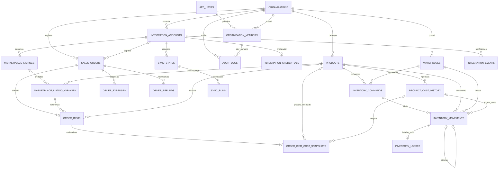

# 12 — Etapa 02A: revisão arquitetural e modelagem revisada

**Status: direção arquitetural aprovada com ressalvas; ajustes 02A.1 aguardam revisão. Não autoriza implementação.** Revisão iniciada em 04/11/2026 e concluída em 05/11/2026 (America/Sao_Paulo), baseada no commit `9f8223ebdb8a2ac52011a18e453f941d760416cb`. Branch: `feature/etapa-02-modelagem`.

Foram lidos integralmente AGENTS.md, README.md, docs/01 a docs/11 e database/001_initial.sql. Este documento consolida as decisões propostas e explicita divergências do blueprint; os documentos anteriores e o SQL permanecem como referência histórica. Nenhum SQL foi executado, nem schema Prisma, migration, seed, endpoint ou integração foi criado.

A Etapa 02A.1 incorpora integralmente o [comentário de revisão do PR #1](https://github.com/enricozambrano/SellerOS/pull/1#issuecomment-6672792168), de 05/11/2026 no fuso America/Sao_Paulo. A matriz da seção 12 registra o parecer recebido, distinguindo aprovação da direção, ressalvas e validações ainda não executadas.

## 1. Resumo executivo

Recomenda-se PostgreSQL 17, modelo relacional com 22 tabelas e duas views conceituais. O domínio continua pequeno: catálogo, vendas, custos estimados, estoque manual, integrações de leitura e auditoria. Não entram contabilidade, contas a pagar/receber, compras completas, CRM, fiscal, kits, reservas, lotes ou FIFO.

As mudanças centrais são:

- Toda relação de domínio inclui organização na FK. RLS protege acesso e escrita; membership continua necessário para autorização.
- Produto/SKU, anúncio, unidade vendável externa e item vendido são distintos. Um anúncio sem variações tem uma unidade vendável base; qualquer unidade pode permanecer sem produto interno.
- Custos de aquisição têm vigência e revisões imutáveis. Custos usados nas vendas têm snapshots próprios versionados, sem copiar automaticamente novos custos para o passado.
- Pedidos manuais e importados compartilham o domínio, com origem explícita; o canal deriva da conta. Pagamento, logística, cancelamento e reembolso são dimensões separadas.
- Perda é um subtipo de movimento: quantidade, produto, depósito, ator e custo existem somente no ledger. Constraints diferidas garantem exatamente um detalhe de perda para cada movimento loss.
- Sincronização tem cursor durável, lease e geração; eventos persistidos funcionam como inbox recuperável. Redis não é a única fonte do trabalho pendente.

A modelagem admite os três providers, mas só Mercado Livre será integrado primeiro, somente leitura. Os exemplos Shopee são fictícios e não afirmam disponibilidade de API. Importar pedido nunca movimenta estoque, histórico ou recente, nesta versão.

## 2. Convenções do dicionário

Os campos descritos são a proposta completa para o MVP. `?` significa NULL permitido; sem `?`, NOT NULL. Campos agrupados na mesma célula têm o mesmo tipo. `U` = uuid; `T` = timestamptz; `S` = text; `J` = jsonb; `I` = integer; `B` = boolean; `C` = char(3); `D6` = numeric(20,6); `D2` = numeric(20,2). Estados são enums PostgreSQL enumerados na seção 5, não texto livre. JSON é objeto com allowlist e limite de tamanho, nunca depósito de payload bruto.

Nas constraints e índices, `org`, `account`, `product`, `order`, `item`, `listing`, `warehouse`, `history` e `reversal` abreviam os respectivos campos `organization_id`, `integration_account_id`, `product_id`, `sales_order_id`, `order_item_id`, `listing_id`, `warehouse_id`, `product_cost_history_id` e `reversal_of_id`; não são colunas adicionais. Defaults só existem quando explicitados; os demais campos obrigatórios são preenchidos pela operação.

**Campos comuns T0**: em todas as tabelas de tenant abaixo, salvo exceções expressas, `id U PK` (UUID gerado), `organization_id U FK organizations(id)`, `created_at T default now()`, `UNIQUE(organization_id,id)`. `organization_id` é imutável. Não há ON UPDATE CASCADE.

**Campos M**: `updated_at T default now()`, atualizado por trigger em toda alteração efetiva; não existe em registros append-only. **Campos A**: `actor_kind enum`, `actor_user_id U?`, `actor_system_code S?`, `correlation_id U`. Exatamente um ator: user exige user_id e system_code NULL; system exige user_id NULL e código permitido. FK de ator humano é `(organization_id,actor_user_id) -> organization_members(organization_id,user_id)`. Membro inativo permanece referenciável; autorização de nova operação exige membro ativo. Código de sistema não é informado livremente pelo cliente.

Quantidades são inteiras no MVP; saldo usa bigint na soma. Produtos fracionados exigem revisão antes de habilitar. Dinheiro não usa float: API futura transportará Decimal como string. Valores monetários e custos são não negativos e finitos, incluindo rejeição explícita de NaN/infinito. NULL é desconhecido; zero exige evidência de custo/valor zero. Nenhum valor financeiro tem default zero. `reversal_of_id` é obrigatório se e somente se movement_type=reversal; custo de reversão copia também basis e referência histórica do original. Moeda de catálogo/estoque é a da organização, inicialmente BRL, imutável após primeiro fato financeiro; outras moedas de pedido podem ser guardadas, mas não recebem custo BRL nem entram em agregação conjunta. Não há câmbio no MVP.

**FK padrão**: toda referência entre tabelas T0 usa `(organization_id,foreign_id) -> (organization_id,id)`, inclusive autorreferências e FKs opcionais. As exceções de PK e as FKs adicionais de mesma conta/pedido/produto estão explicitadas abaixo. Relação opcional usa MATCH SIMPLE com organização sempre obrigatória. Atributos de identidade externa são case-sensitive, não vazios; não converter IDs numéricos para Number nem remover zeros. Todos os DELETE/UPDATE de chaves usam RESTRICT/NO ACTION, salvo procedimentos de expurgo explicitamente separados da aplicação.

## 3. Dicionário de dados e responsabilidades

### 3.1 Identidade e empresas (3 tabelas)

| Tabela               | Campos e tipos                                                                                                              | Chaves, responsabilidade e regras                                                                                                                                                                              |
| -------------------- | --------------------------------------------------------------------------------------------------------------------------- | -------------------------------------------------------------------------------------------------------------------------------------------------------------------------------------------------------------- |
| app_users            | id U PK; auth_issuer S?; auth_subject S?; email S?; name S?; status enum; created_at T; updated_at T                        | Perfil global, sem senha. UNIQUE(auth_issuer,auth_subject); ambos presentes para active, ambos NULL para anonymized. Subject só é único dentro do issuer. Email opcional, não é chave de login. Atualização M. |
| organizations        | id U PK; name S; currency_code C default BRL; timezone S default America/Sao_Paulo; status enum; created_at T; updated_at T | Tenant; status active/suspended/pending_deletion. Validar timezone IANA e moeda suportada. Não contém CPF/CNPJ/endereço.                                                                                       |
| organization_members | organization_id U; user_id U; role enum; status enum; joined_at T; updated_at T                                             | PK(organization_id,user_id); FKs organizations e app_users. N:N usuário/organização. Sem T0. Manter tombstone inactive. Último owner ativo não pode ser removido de organização active.                        |

Papéis: owner administra organização, membros, contas e operação; admin administra operação e contas, não transfere propriedade nem exclui tenant; operator gerencia catálogo, vínculos, vendas manuais e estoque, sem credenciais/membros; viewer somente leitura sanitizada. Apenas owner aparece inicialmente na UI. Matriz fica no código de autorização, sem tabelas genéricas de permissões no MVP. Todos os papéis exigem membership ativo; roles do banco separam privilégios técnicos, não substituem esses papéis.

### 3.2 Contas, catálogo externo e processamento (6 tabelas)

| Tabela                       | Campos adicionais a T0                                                                                                                                                                                                                                        | Chaves, responsabilidade e regras                                                                                                                                                                                                                                                                                                                   |
| ---------------------------- | ------------------------------------------------------------------------------------------------------------------------------------------------------------------------------------------------------------------------------------------------------------- | --------------------------------------------------------------------------------------------------------------------------------------------------------------------------------------------------------------------------------------------------------------------------------------------------------------------------------------------------- |
| integration_accounts         | provider enum; external_account_scope S; external_seller_id S; display_name S?; connection_status enum; identity_contract_version S; connected_at T; disconnected_at T?; M                                                                                    | UNIQUE(provider,external_account_scope,external_seller_id) global. Escopo é namespace canônico de identidade definido pelo adapter, não rótulo arbitrário. Reconexão reutiliza a conta. FK não transfere tenant.                                                                                                                                    |
| integration_credentials      | organization_id U; integration_account_id U PK; encrypted_bundle bytea; nonce bytea; auth_tag bytea; key_version S; algorithm S; access_expires_at T?; refreshed_at T?; credential_version I; refresh_lease_token U?; refresh_lease_until T?; created_at T; M | Exceção sem T0/id; FK composta à conta, UNIQUE(org,account). Envelope cifra access/refresh token e scopes; refresh token pode faltar dentro do envelope. Algorithm restrito a AES-256-GCM; nonce 12 bytes, tag 16 bytes; version > 0. Lease campos ambos NULL ou presentes. Acesso exclusivo do serviço de integração.                              |
| marketplace_listings         | integration_account_id U; external_item_id S; title S; raw_status S?; external_updated_at T?; synced_at T; archived_at T?; M                                                                                                                                  | Anúncio pai. UNIQUE(org,account,external_item_id); UNIQUE(org,account,id). FK conta. Não tem produto nem estoque físico.                                                                                                                                                                                                                            |
| marketplace_listing_variants | integration_account_id U; listing_id U; external_variant_id S?; product_id U?; external_sku S?; title S?; currency_code C?; current_price D6?; monetary_evidence J; external_available_quantity I?; external_updated_at T?; synced_at T; archived_at T?; M    | Unidade vendável. FK (org,account,listing) -> listings(org,account,id); FK conta e produto. UNIQUE(org,listing,external_variant_id) NULLS NOT DISTINCT; UNIQUE(org,account,id). NULL identifica a única unidade base, nunca string vazia. Quantidade externa desconhecida = NULL; negativa é rejeitada na normalização. Preço presente exige moeda. |
| sync_states                  | integration_account_id U; resource enum; cursor J?; watermark_at T?; generation bigint; lease_token U?; lease_until T?; last_success_at T?; next_attempt_at T?; M                                                                                             | UNIQUE(org,account,resource). Cursor durável por conta/recurso, geração >= 0, lease pareado. Resource orders/listings. Não contém tokens ou URLs assinadas. FK conta.                                                                                                                                                                               |
| sync_runs                    | sync_state_id U; kind enum; status enum; checkpoint J?; rows_upserted bigint default 0; attempt_count I default 0; generation bigint; lease_token U?; error_code S?; started_at T?; finished_at T?; M                                                         | FK sync_state. Registro de execução/tentativas, não fonte exclusiva do cursor. Recursos/conta derivados do estado. UNIQUE parcial(sync_state_id) WHERE status=running. Contadores >= 0. Terminal exige finished_at; running exige started_at e lease_token.                                                                                         |

A tabela de eventos está na seção 3.6 para manter sua função de inbox explícita. Total desta seção: seis tabelas; eventos completam a infraestrutura de integração.

Anúncio pode existir ainda sem unidades durante importação incompleta. Após leitura completa, terá uma base sem variações ou unidades com IDs externos. A troca de estrutura arquiva unidades antigas e cria as novas; não altera identidades nem remove referências de vendas. Não se permite unidade base ativa junto com variantes ativas: trigger serializa no anúncio e valida conjunto. Uma variante aponta a zero ou um produto, um produto a muitas variantes em contas distintas; kits/múltiplos produtos na mesma variante ficam fora do MVP. Mudança de vínculo afeta vendas futuras, nunca remapeia silenciosamente itens históricos.

### 3.3 Catálogo e custos (2 tabelas)

| Tabela               | Campos adicionais a T0                                                                             | Chaves, responsabilidade e regras                                                                                                                                                                                                                                  |
| -------------------- | -------------------------------------------------------------------------------------------------- | ------------------------------------------------------------------------------------------------------------------------------------------------------------------------------------------------------------------------------------------------------------------ |
| products             | sku S; name S; description S?; active B default true; M                                            | UNIQUE(org,sku). SKU normalizado como trim + maiúsculas ASCII, padrão `[A-Z0-9._-]+`, até 80 caracteres; sem reciclar SKU de produto inativo. Não contém current_unit_cost.                                                                                        |
| product_cost_history | product_id U; effective_at T; revision I; unit_cost D6?; currency_code C; source enum; reason S; A | Append-only. UNIQUE(org,product,effective_at,revision); UNIQUE(org,product,id). FK produto. Revision > 0; moedas compatíveis com organização. NULL pode marcar vigência de custo desconhecido. Fonte manual/purchase/import é proveniência, não módulo de compras. |

Custo vigente em instante t: filtrar effective_at <= t, ordenar effective_at DESC e revision DESC, tomar uma linha. Cada vigência vale até a próxima; para corrigir a mesma vigência, adicionar revision seguinte sob lock no produto. Não usar intervalos sobrepostos nem coluna duplicada de custo atual. Sem linha anterior ou com unit_cost NULL, custo desconhecido. Consulta conceitual `product_current_costs` usa a mesma regra em now(); custo futuro não vigora antecipadamente. Retroatividade só muda consultas futuras ao histórico, não snapshots já registrados.

### 3.4 Vendas e financeiro estimado (5 tabelas)

| Tabela                    | Campos adicionais a T0                                                                                                                                                                                                                                                                                                                                                                                                                                                                                                                                                                                             | Chaves, responsabilidade e regras                                                                                                                                                                                                                                                                                                                                                                                     |
| ------------------------- | ------------------------------------------------------------------------------------------------------------------------------------------------------------------------------------------------------------------------------------------------------------------------------------------------------------------------------------------------------------------------------------------------------------------------------------------------------------------------------------------------------------------------------------------------------------------------------------------------------------------ | --------------------------------------------------------------------------------------------------------------------------------------------------------------------------------------------------------------------------------------------------------------------------------------------------------------------------------------------------------------------------------------------------------------------- |
| sales_orders              | integration_account_id U?; origin enum; external_order_id S?; manual_request_key S?; manual_request_hash S?; sold_at T; paid_at T?; cancelled_at T?; external_updated_at T?; last_fetched_at T?; payment_status enum; fulfillment_status enum; cancellation_status enum; refund_status enum; raw_statuses J?; currency_code C; items_gross_amount D2?; discount_amount D2?; buyer_shipping_amount D2?; order_total_amount D2?; expenses_complete B default false; refunds_complete B default false; financial_assessment J; monetary_evidence J; source_revision S?; normalized_hash S?; version I default 1; A; M | FK conta opcional. UNIQUE(org,account,external_order_id) para imported; UNIQUE(org,manual_request_key) para manual; UNIQUE(org,id,account). Source provider derivado da conta. Origin manual exige conta/external NULL e manual_request_key/manual_request_hash presentes; imported exige conta/external e ambos os campos manuais NULL. sold_at obrigatório, nunca usar data de importação como fallback silencioso. |
| order_items               | sales_order_id U; integration_account_id U?; listing_variant_id U?; product_id U?; line_key S; external_item_id S?; external_variant_id S?; seller_sku_snapshot S?; title_snapshot S; quantity I; unit_price D6?; line_gross_amount D2?; line_discount_amount D2?; monetary_evidence J; captured_at T; M                                                                                                                                                                                                                                                                                                           | FK pedido sempre (org,order); FK adicional (org,order,account) -> orders(org,id,account). FK (org,account,variant) -> variants(org,account,id); FK produto. UNIQUE(org,order,line_key). Quantity > 0. Trigger exige conta igual à do pedido, inclusive NULL; variant exige conta. Produto/variante opcionais, custo não depende de haver anúncio importado.                                                           |
| order_item_cost_snapshots | order_item_id U; product_id U?; product_cost_history_id U?; revision I; quantity_snapshot I; unit_cost_snapshot D6?; currency_code C; basis enum; reason S; A                                                                                                                                                                                                                                                                                                                                                                                                                                                      | Append-only, FK item e produto; FK (org,product,history) -> cost_history(org,product,id). UNIQUE(org,item,revision). Quantity > 0 e revision > 0. Cost source exige history/product e mesmo valor/moeda da linha histórica; unknown exige custo/history NULL; override/imported exige custo conhecido, history NULL. Snapshot inclui produto e quantidade usados, mesmo em revisão posterior.                         |
| order_expenses            | sales_order_id U; category enum; entry_key S; amount D2?; basis enum; source enum; external_reference S?; evidence J; reason S?; A; M                                                                                                                                                                                                                                                                                                                                                                                                                                                                              | FK pedido. UNIQUE(org,order,entry_key). Moeda herdada do pedido. Basis unknown exige amount NULL, estimated/confirmed exige amount presente. Source manual/imported; imported só em pedido imported. category marketplace_fee/seller_shipping/tax/advertising/packaging/other. Correções auditadas; identidade imutável.                                                                                              |
| order_refunds             | sales_order_id U; entry_key S; external_reference S?; status enum; amount D2?; occurred_at T?; source enum; evidence J; A; M                                                                                                                                                                                                                                                                                                                                                                                                                                                                                       | FK pedido. UNIQUE(org,order,entry_key). Moeda herdada. Source manual/imported coerente com pedido. Reembolso agregado por ocorrência, sem presumir retorno físico. Amount conhecido quando succeeded; demais estados podem ter NULL. Correções de fonte auditadas.                                                                                                                                                    |

As cinco tabelas acima incluem a nova tabela de snapshots; reembolsos tornam explícitas múltiplas ocorrências parciais. Não se cria pagamento bancário, saldo financeiro ou recebível. Cada item recebe revision 1 de custo, mesmo desconhecido, no mesmo commit: trigger diferida exige pelo menos um snapshot por item e valida quantidade/produto do snapshot inicial. Revisões posteriores são explícitas e auditadas; a maior revision é a estimativa vigente, anteriores permanecem consultáveis. Não há current_snapshot_id redundante. Toda nova revisão valida produto/quantidade contra o item no instante da criação e moeda contra o pedido, sob lock; um produto histórico pode divergir do vínculo atual após correção explícita. History só é permitido para basis=product_cost_at_sale, com custo conhecido; custo desconhecido usa basis=unknown mesmo se a vigência consultada contém NULL.

`line_key` é identidade estável produzida pelo adapter, não posição no array. Preferir ID de linha do provedor. Se não existir, uma chave derivada só será admitida após contrato do adapter provar estabilidade e reconciliação em atualizações; agrupamento de linhas economicamente idênticas requer essa mesma prova. Sem ela, manter importação pendente para reconciliação, sem inventar chave por posição/preço mutável. Mudança que não possa ser reconciliada sem ambiguidade interrompe a atualização e exige revisão; nunca anexar linhas arbitrárias. Manual usa UUID de linha imutável em texto.

Preço, título, SKU e quantidade são snapshots comerciais: não mudam com catálogo ou anúncio. Divergência real da fonte exige operação de correção com lock do pedido e auditoria de valores anteriores/novos; sem DELETE de itens. Correção que altera composição não é um upsert cego: requer reconciliação explícita e novo snapshot de custo quando aprovado. O MVP não implementa pedidos rascunho: ao commit exige pelo menos um item, via trigger diferida. Payload incompleto fica pendente na inbox/sync, não fabrica pedido financeiro.

### 3.5 Estoque e perdas (4 tabelas)

| Tabela              | Campos adicionais a T0                                                                                                                                                                                                | Chaves, responsabilidade e regras                                                                                                                                                                                                                                                                                                                                                                                               |
| ------------------- | --------------------------------------------------------------------------------------------------------------------------------------------------------------------------------------------------------------------- | ------------------------------------------------------------------------------------------------------------------------------------------------------------------------------------------------------------------------------------------------------------------------------------------------------------------------------------------------------------------------------------------------------------------------------- |
| warehouses          | name S; active B default true; M                                                                                                                                                                                      | UNIQUE(org,name). Depósito interno; um depósito padrão pode ser criado no onboarding futuro.                                                                                                                                                                                                                                                                                                                                    |
| inventory_movements | warehouse_id U; product_id U; movement_type enum; quantity_delta I; unit_cost_snapshot D6?; product_cost_history_id U?; cost_basis enum; currency_code C; reversal_of_id U?; command_id U; reason S; occurred_at T; A | FKs depósito, produto, reversal e (org,product,history). Append-only. FK (org,command_id) -> inventory_commands(org,id); UNIQUE(org,command_id); UNIQUE(org,reversal_of_id) quando presente. Quantidade não zero; loss/sale negativos; opening/purchase/return positivos; adjustment assinado; reversal exato oposto. Custo da fonte history deve coincidir; unknown exige NULL; override exige custo conhecido e history NULL. |
| inventory_losses    | organization_id U; inventory_movement_id U PK; reason enum; description S?; created_at T                                                                                                                              | Exceção sem T0/id/A: FK (org,movement) -> movements(org,id), UNIQUE(org,movement). Subtipo append-only, reason damaged/lost/expired/inventory_discrepancy/other. Produto, depósito, ator, ocorrido_em, quantidade e custo são derivados do movimento.                                                                                                                                                                           |

**inventory_commands — recibo idempotente de operação de estoque (nova na 02A.1).** Campos T0 e A, mais `idempotency_key S`, `request_hash S`, `request_version I`, `reason S`, `occurred_at T`, `product_id U`, `warehouse_id U`, `operation enum`, `target_quantity bigint?`, `requested_delta I?`, `balance_before bigint`, `balance_after bigint`, `outcome enum`, `completed_at T`. FKs compostas a produto/depósito; UNIQUE(org,idempotency_key), índice (org,product_id,warehouse_id,created_at). Operation = absolute_adjustment ou movement; a primeira exige target_quantity e requested_delta NULL, a segunda exige requested_delta não zero e target_quantity NULL. Outcome = applied ou no_op. Append-only; apenas resultados concluídos são persistidos, na mesma transação de seus efeitos. Request_version > 0; no_op só em ajuste absoluto e exige before=after=target; applied exige after diferente de before. Para absolute_adjustment, after=target; para movement, after-before=requested_delta.

Constraint trigger diferida garante comando applied com exatamente um movimento e no_op com nenhum; o movimento tem mesmo tenant, produto, depósito e ator, e quantity_delta=balance_after-balance_before. Cada movimento tem um único comando. O ledger continua proibindo quantidade zero. Delta fora do intervalo integer é rejeitado, sem truncamento. Correção com estorno e novo lançamento usa dois comandos/chaves derivados de uma solicitação, no mesmo commit. Recibos têm retenção equivalente ao ledger e não expiram durante retries válidos; só saem no expurgo controlado do tenant. Esta tabela evita usar auditoria polimórfica como estado transacional ou fabricar movimento zero. Sua adição é proposta nesta revisão e depende da aprovação do documento atualizado.

`inventory_balances` é view conceitual: soma quantity_delta por (org,warehouse,product), resultado bigint; não uma tabela de saldo editável. Não se cria posição de estoque/custo médio. Relatório de perdas deriva quantidade = -quantity_delta e valor = round(quantidade * unit_cost_snapshot,2); NULL continua NULL. Movimento loss exige exatamente uma linha de detalhe ao commit, e todo detalhe exige movimento loss negativo. A cardinalidade condicionada é assegurada por trigger de constraint diferida nos dois lados; FK/PK sozinhas não garantem existência inversa.

Estornar perda cria movimento reversal positivo com reversal_of_id apontando à saída, sem segundo detalhe de perda. Relatório mantém perda bruta e estorno separadamente, permitindo total líquido e eventos por data. Estorno só pode referenciar movimento original, nunca outro reversal; um original tem no máximo um estorno completo. Produto, depósito, moeda, custo (comparação NULL-safe) e módulo da quantidade devem ser idênticos; nenhuma revisão altera o original. Correção parcial usa estorno completo e novo movimento/perda na mesma transação.

Saldo negativo foi aprovado com ressalvas: será permitido somente com alerta visível e rastreabilidade, pois o ledger inicial pode estar incompleto. Isso não elimina serialização: operação de ajuste absoluto calcula delta a partir do saldo sob lock; movimentos concorrentes precisam participar do mesmo protocolo. Reserva de estoque e proibição de saldo negativo não fazem parte do MVP proposto; permanecem fora do MVP; as condições de A06 são detalhadas na seção 7.3.

### 3.6 Inbox e auditoria (2 tabelas)

| Tabela             | Campos adicionais a T0                                                                                                                                                                                                                               | Chaves, responsabilidade e regras                                                                                                                                                                                                                                                                 |
| ------------------ | ---------------------------------------------------------------------------------------------------------------------------------------------------------------------------------------------------------------------------------------------------- | ------------------------------------------------------------------------------------------------------------------------------------------------------------------------------------------------------------------------------------------------------------------------------------------------- |
| integration_events | integration_account_id U; event_key S; topic S; resource_id S; external_sent_at T?; payload_minimal J?; status enum; attempt_count I default 0; next_attempt_at T?; lease_token U?; lease_until T?; received_at T; processed_at T?; error_code S?; M | FK conta. UNIQUE(org,account,event_key). Inbox durável e recuperável; topic/resource_id permitidos pelo adapter; nunca URL arbitrária executável. Lease pareado e obrigatório em processing. Processed exige processed_at.                                                                        |
| audit_logs         | action S; entity_type S; entity_id U; details_minimal J; A                                                                                                                                                                                           | Append-only. Tipos/ações de catálogo controlado; referência polimórfica informativa, deliberadamente sem FK para sobreviver à anonimização/expurgo. Não serve de relacionamento de negócio. JSON só valores permitidos, IDs, razões, revisões e diffs numéricos; sem tokens, e-mails ou payloads. |

**Inventário total: 22 tabelas**, conforme dicionário (3 + 6 + 2 + 5 + 4 + 2), e duas views. O acréscimo sobre as 17 tabelas iniciais é de cinco: variants, snapshots de custo, refunds, sync_states e inventory_commands. A revisão 02A tinha 21; a 02A.1 acrescenta apenas o recibo necessário à idempotência de no-op.

## 4. Diagrama ER

O diagrama mostra as 22 tabelas e cardinalidades principais. As FKs usam organização mesmo onde a aresta é abreviada. As arestas de ator em todas as tabelas A e as relações de ownership em todas as T0 são omitidas para legibilidade, permanecendo obrigatórias no dicionário. `INVENTORY_LOSSES` é 0..1 para movimentos gerais e exatamente 1 para o subtipo loss.

## 5. Estados, enums e transições

| Campo/família               | Valores propostos e semântica                                                           |
| --------------------------- | --------------------------------------------------------------------------------------- |
| app_users.status            | active, disabled, anonymized                                                            |
| organizations.status        | active, suspended, pending_deletion                                                     |
| member.role / status        | owner, admin, operator, viewer / active, inactive                                       |
| provider                    | mercado_livre, shopee, tiktok_shop                                                      |
| connection_status           | pending, connected, expired, needs_reauth, error, disconnected                          |
| actor_kind                  | user, system; códigos system: sync_worker, maintenance, bootstrap                       |
| origin                      | manual, imported; canal manual ou provider derivado                                     |
| payment_status              | unknown, pending, partially_paid, paid, failed; reembolso não apaga pagamento histórico |
| fulfillment_status          | unknown, unfulfilled, processing, shipped, delivered, returned, not_applicable          |
| cancellation_status         | unknown, none, requested, cancelled                                                     |
| sales_orders.refund_status  | unknown, none, partial, full; projeção do total de refunds confirmados quando completo  |
| order_refunds.status        | pending, succeeded, failed, cancelled                                                   |
| product_cost_history.source | manual, purchase, import                                                                |
| snapshot.basis              | unknown, product_cost_at_sale, manual_override, imported                                |
| inventory cost_basis        | unknown, product_cost_at_event, manual_override                                         |
| expense.basis / source      | unknown, estimated, confirmed / manual, imported                                        |
| expense.category            | marketplace_fee, seller_shipping, tax, advertising, packaging, other                    |
| movement_type               | opening, purchase, sale, return, loss, adjustment, reversal                             |
| loss.reason                 | damaged, lost, expired, inventory_discrepancy, other                                    |
| sync resource / kind        | orders, listings / initial, incremental, manual, webhook_recovery                       |
| sync status                 | queued, running, retry_wait, succeeded, failed, cancelled                               |
| event status                | received, processing, retry_wait, processed, dead_letter                                |

Estado desconhecido é explicitamente unknown, nunca paid/none por omissão. Transições externas não formam uma ordem numérica: delivered não deve voltar a shipped por evento antigo, mas uma correção oficial pode alterar estados. Adapter compara revisão externa e usa leitura atual; empate com conteúdo divergente exige nova consulta ou revisão. Pedido manual só muda por ação autorizada/auditada. Pagamento paid exige paid_at; cancelled exige cancelled_at; igualdade inversa não é presumida porque histórico pode preservar essas datas.

Runs: queued -> running -> succeeded/failed/cancelled/retry_wait; retry_wait -> running, com nova lease. Eventos: received/retry_wait -> processing -> processed/retry_wait/dead_letter. Lease vencida torna trabalho recuperável; dead_letter exige ação explícita para reabrir. Cada tentativa aumenta contador. Conta desconectada não autoriza novos jobs nem mantém tokens. Consistência entre conta connected e credencial existente será verificada por trigger diferida; pending/needs_reauth/disconnected podem não ter credencial.

## 6. Integridade e isolamento

### 6.1 Tenant, conta e autorização

FK composta é obrigatória já na Etapa 02B: movimento com organization A e product B falha no PostgreSQL, mesmo que inserido fora do ORM. PK UUID global facilita referências, mas não substitui UNIQUE(org,id). Pertencer ao mesmo tenant não basta para relacionar item de uma conta a anúncio de outra: FKs adicionais de conta na seção 3.4 impedem essa mistura. Trigger cobre igualdade com conta NULL que MATCH SIMPLE sozinho não garantiria.

RLS será ENABLE + FORCE em todas as tabelas de tenant e organizations. Policies usam contexto transacional definido pelo backend após validar identidade/membership, com USING e WITH CHECK; sem contexto, negar acesso. O papel runtime não é dono, superuser ou BYPASSRLS e não pode TRUNCATE, alterar policy ou desabilitar triggers. app_users tem política própria para perfil do sujeito autenticado, sem enumeração global; membership tem leitura limitada ao próprio usuário e operações administrativas mediadas. Bootstrap de tenant/membro usa caminho privilegiado mínimo e transacional, sem entregar credencial administrativa à aplicação geral.

Usar contexto local à transação, nunca configuração persistente na conexão do pool. Worker atua com tenant obtido de registro de conta validado, também sob RLS; descoberta global de trabalhos usa função/role restrito que retorna só identificadores de trabalho. Credenciais não recebem SELECT do papel comum da API. RLS por variável de sessão não autentica o portador de credenciais do banco: backend e segredos de conexão são fronteira de confiança; não expor banco ao cliente. FKs protegem relações independentemente dessa confiança. Erros de constraints são traduzidos sem revelar existência de registros de outro tenant.

A documentação do PostgreSQL distingue constraints relacionais de políticas por linha e os privilégios que contornam RLS. Ver [constraints PostgreSQL 17](https://www.postgresql.org/docs/17/ddl-constraints.html) e [RLS PostgreSQL 17](https://www.postgresql.org/docs/17/ddl-rowsecurity.html). As escolhas de tenant/contexto acima são decisões do SellerOS.

### 6.2 Índices recomendados

PKs e UNIQUE do dicionário já criam índices; não duplicá-los. Os índices de leitura de domínio começam com organization_id; a descoberta de memberships por usuário é a exceção global explicitada abaixo. Além deles:

| Tabela                         | Índice/finalidade                                                                                                               |
| ------------------------------ | ------------------------------------------------------------------------------------------------------------------------------- |
| organization_members           | (user_id,status,organization_id), descoberta de empresas do usuário                                                             |
| marketplace_listings           | (org,account,external_updated_at), incremental                                                                                  |
| marketplace_listing_variants   | (org,product_id); (org,listing_id); parcial (org,id) WHERE product_id IS NULL AND archived_at IS NULL                           |
| product_cost_history           | (org,product,effective_at DESC,revision DESC), busca temporal                                                                   |
| sales_orders                   | (org,sold_at DESC,id); (org,account,sold_at DESC,id); (org,payment_status,cancellation_status,sold_at DESC), filtros principais |
| order_items                    | (org,product_id); (org,account,listing_variant_id); UNIQUE org/order/line_key cobre leitura dos itens por pedido                |
| order_item_cost_snapshots      | UNIQUE org/item/revision atende busca reversa; (org,product,product_cost_history_id) apoia FK                                   |
| order_expenses / order_refunds | UNIQUE org/order/entry_key atende consulta por pedido                                                                           |
| inventory_movements            | (org,warehouse,product); (org,occurred_at DESC,id); (org,product,product_cost_history_id)                                       |
| sync_runs                      | (org,sync_state_id,created_at DESC); parcial de running descrito no dicionário                                                  |
| integration_events             | (org,status,next_attempt_at,received_at,id), retomada; (org,account,received_at DESC)                                           |
| audit_logs                     | (org,created_at DESC,id); (org,entity_type,entity_id,created_at DESC)                                                           |

Adicionar índice para cada FK não coberta por prefixo existente na implementação (incluindo atores e parent IDs); avaliar custo de escrita. Sem índices GIN em JSON nem particionamento prematuro. Validar planos com volume representativo na 02B; os índices de dashboard são candidatos, não promessa de performance.

### 6.3 Complementos SQL ao Prisma (somente especificação)

As migrations futuras serão a única trilha executável. Schema Prisma descreve tabelas, enums, tipos nativos, FKs compostas e uniques representáveis. SQL customizado na mesma migration deverá conter:

1. CHECKs de origem, nulabilidade pareada, sinais, finitude, custos, atores, timestamps/estados, identidade não vazia e schema mínimo de evidência financeira.
2. UNIQUE NULLS NOT DISTINCT das variantes e índices condicionais que a versão adotada do Prisma não representar. Não usar COALESCE com sentinela que colida com ID real.
3. RLS, policies, roles/grants e funções de contexto/descoberta restritas; ambas as views com segurança do invocador para não contornar RLS.
4. Triggers de updated_at; bloqueio de UPDATE/DELETE nos fatos imutáveis e bloqueio de mudanças em identidade/organization_id.
5. Constraint triggers diferidas para comando/efeito (incluindo no_op), perda/movimento nos dois sentidos; pedidos com itens; itens com snapshot; conta conectada com credencial; igualdade NULL-safe nos estornos/custos e coerência de conta do item.
6. Triggers de serialização/validação para estornos, snapshots, variante base versus variantes, moeda, último owner e projeção/invalidação de completude financeira. Triggers agregadas tomam lock no pai antes de verificar o conjunto, prevenindo write skew.
7. Views inventory_balances e product_current_costs; rotinas transacionais restritas para ledger, revisão de custo e expurgo.

CHECK não deve consultar outra tabela. Relações cross-row usam FK, trigger ou rotina com privilégios restritos. Transação no serviço sozinha não protege escrita direta; runtime não terá DML irrestrito em ledger/custos/auditoria. Triggers bloqueiam mutação mesmo se um caminho acidental de ORM tentar fazê-la. Roles de migração/manutenção são separadas.

A [documentação oficial de Prisma Migrate](https://www.prisma.io/docs/orm/v7/prisma-migrate/workflows/unsupported-database-features) orienta personalizar migrations para triggers e views; ela já documenta suporte a índices parciais em versões atuais. A versão do projeto ainda será escolhida: não assumir que todo índice especial é ou não suportado. Na 02B, testar introspecção/diff e preservar SQL customizado. Nunca executar database/001_initial.sql em paralelo, nem usar db push como trilha de produção.

### 6.4 Contrato de execução RLS e prova técnica com Prisma

Especificação para 02B.1, não código executado nesta revisão. Separar credenciais/pools por capacidade; nenhum cliente de usuário recebe acesso direto ao PostgreSQL.

| Role técnico   | Poder permitido                                                                                                                                   | Limites obrigatórios                                                                                                                                     |
| -------------- | ------------------------------------------------------------------------------------------------------------------------------------------------- | -------------------------------------------------------------------------------------------------------------------------------------------------------- |
| migration      | DDL e gestão dos objetos/policies no pipeline autorizado; proprietário dos objetos, preferencialmente role dona NOLOGIN assumida só pelo migrador | Credencial fora de API/worker; não usar para testes de isolamento; não conceder membership desta role ao runtime                                         |
| runtime_api    | Leitura/escrita permitida por tabela/rotina sob RLS e contexto de usuário/tenant                                                                  | NOSUPERUSER, NOBYPASSRLS, não proprietário; sem DDL, TRUNCATE, SET ROLE privilegiado, alteração de policy/trigger ou SELECT de credencial                |
| runtime_worker | Mesmo isolamento, mas ator system e grants de recursos de integração; credencial acessível só ao processo autorizado                              | Contexto obtido de trabalho/conta persistido e validado, nunca de org do webhook; sem bypass global; sem permissão de administrar membros                |
| bootstrap      | EXECUTE apenas da rotina de onboarding, que cria tenant e primeiro owner atomicamente                                                             | Não é uma credencial genérica disponível ao runtime; vínculo ao sujeito autenticado validado; não aceita escolher tenant existente para se tornar owner  |
| maintenance    | Rotinas nominadas de anonimização, expurgo e rotação, com alvo/motivo explícitos e auditoria                                                      | Separada do runtime/migration; sem bypass amplo por padrão; excepcional acesso entre tenants apenas em função restrita revisada, não em consultas livres |

Funções privilegiadas, quando indispensáveis, terão dono dedicado sem login, privilégios mínimos, search_path fixo, nomes qualificados, ausência de SQL dinâmico arbitrário e EXECUTE revogado de PUBLIC. A exceção de bootstrap só autoriza criação do novo tenant e seu owner, não leitura global. A função de descoberta de trabalho devolve IDs mínimos; worker revalida conta e lease no contexto do tenant antes de alterar dados. Não depender de policy recursiva que consulta a própria tabela membership: a leitura inicial do vínculo usa sujeito já validado e regra própria; funções auxiliares necessárias são revisadas para não ampliar acesso.

**Unidade transacional:** após validar identidade, abrir transação interativa pelo Prisma. No mesmo cliente transacional/conexão, definir parâmetros locais de sujeito, organização e tipo de ator com valores parametrizados; verificar membership ativo e tenant ativo; executar consultas somente pelo cliente transacional recebido pelos repositórios; concluir ou fazer rollback. A validação do vínculo ocorre antes de qualquer acesso de domínio. Não usar cliente global dentro do callback, extensão que configura contexto em conexão diferente nem SET de sessão persistente. Parâmetros ausentes, vazios, malformados ou incompatíveis com o ator resultam em negação/erro controlado, jamais fallback para todos os tenants.

Policies de domínio exigem org da linha igual ao contexto (organizations usa id), contexto válido e autorização apropriada de usuário/worker. USING limita leitura/linhas alteráveis; WITH CHECK impede inserção/troca para outro tenant. ENABLE + FORCE RLS, FKs compostas e proibição de trocar organization_id são complementares. Mesmo uma operação com filtro esquecido deve falhar fechada. Variáveis de contexto não autenticam quem já possui a credencial do banco: o backend é parte da fronteira de confiança; testes não devem afirmar proteção contra comprometimento desse backend. Superuser/BYPASSRLS e dono capaz de alterar policies ficam fora do runtime, conforme [PostgreSQL 17 RLS](https://www.postgresql.org/docs/17/ddl-rowsecurity.html).

Prisma/driver/pool precisam fixar a conexão durante toda a transação; isso será provado com o conjunto real escolhido. Não adotar pool em modo statement para esse fluxo. Pool externo em modo transação só após teste do driver e parâmetros locais; conexão devolvida após commit/rollback não pode conservar contexto ativo. A [documentação de transações Prisma](https://www.prisma.io/docs/orm/fundamentals/transactions) fundamenta usar o cliente da transação em todas as operações; a API concreta depende da versão ainda a fixar. Sem transação/contexto explícito, acesso de domínio é negado. Tratar timeout, rollback e cancelamento como caminhos normais de teste.

**Matriz mínima da porta 02B.1:**

| Caso                 | Preparação/ação futura                                                                | Resultado esperado                                                                                             |
| -------------------- | ------------------------------------------------------------------------------------- | -------------------------------------------------------------------------------------------------------------- |
| Roles reais          | Conferir usuário da conexão, dono, atributos e grants no banco                        | Testes de domínio usam runtime, não migration; runtime não assume nenhuma role privilegiada                    |
| Dois tenants         | Usuário U-A só em A, U-B só em B; ler/listar/contar/relacionar com e sem filtro       | A não vê B; joins/includes/aggregates do Prisma também isolados                                                |
| Escritas diretas     | INSERT com org B no contexto A; UPDATE/DELETE por ID B; FK A -> B                     | INSERT/FK recusados; UPDATE/DELETE não afetam B; nenhuma alteração lateral                                     |
| Sem contexto         | Cliente global, parâmetro ausente/vazio/inválido, transação sem inicialização         | Zero linhas ou erro controlado; escrita não confirma                                                           |
| Membership           | Org informada pelo cliente, usuário fora dela, membro inativo, tenant suspenso        | Operação recusada antes do domínio; ator worker não pode ser declarado pelo cliente web                        |
| Reutilização do pool | Pool com uma conexão: A -> commit -> sem contexto -> B; repetir após rollback/timeout | Sem vazamento de contexto; B nunca recebe dados A                                                              |
| Concorrência         | Pool com duas ou mais conexões e barreiras, operações A/B intercaladas                | Isolamento preservado, mesmo com retries                                                                       |
| Bootstrap            | Criar tenant novo e owner; tentar usar tenant existente ou sujeito de terceiro        | Primeiro caso atômico, demais negados; rollback não deixa empresa órfã                                         |
| Worker               | Trabalho persistido de A e identificador malicioso de B; descoberta restrita          | Só recurso da conta validada de A é acessível; descoberta não expõe payloads/tokens                            |
| Views e privilégios  | Ler views como runtime; tentar TRUNCATE/DDL/desabilitar RLS                           | Views respeitam invocador; ações privilegiadas recusadas. Views do domínio são exercitadas quando introduzidas |

Na 02B.1 usar fixture mínima descartável para FK composta e view invocadora; repetir depois com cada tabela/view real. Registrar evidência dos cenários e plano de execução do pool, não apenas teste unitário de repository mockado. A etapa seguinte fica bloqueada se qualquer caso de isolamento falhar.

### 6.5 Identidade externa: contrato por marketplace

A chave global é (provider,external_account_scope,external_seller_id). `identity_contract_version` registra a versão da regra, mas **não** entra na chave: trocar versão não pode criar duplicata. O nome histórico external_seller_id significa identidade da unidade de conta/loja conectada, que varia por provider. Não é e-mail, apelido, access token ou ID do aplicativo.

| Provider      | Identidade que o adapter deverá obter de recurso autenticado                               | Contrato de namespace a validar antes da conexão real                                                                                                                                 |
| ------------- | ------------------------------------------------------------------------------------------ | ------------------------------------------------------------------------------------------------------------------------------------------------------------------------------------- |
| Mercado Livre | ID estável do usuário vendedor autenticado                                                 | Definir namespace do usuário no ambiente autorizado; não assumir que site_id cria outra conta se o usuário é o mesmo                                                                  |
| Shopee        | ID estável da loja autorizada (shop), distinguindo merchant/grupo quando a API os oferecer | Namespace da identidade shop e ambiente/região somente se fizerem parte do escopo real de unicidade; não usar merchant como substituto de shop                                        |
| TikTok Shop   | ID estável da loja autorizada                                                              | Namespace da identidade shop no ambiente/região exigido pelo contrato; identificador opaco de autorização/roteamento só substitui o ID se houver garantia documentada de estabilidade |

Esses são requisitos do adapter, não afirmações de payloads/garantias já verificadas nas APIs. O contrato concreto deve registrar fonte oficial, versão/região/ambiente, campo escolhido, abrangência de unicidade, aliases e fixtures de reconexão. Sem comprovação, a conexão não é habilitada. Shopee/TikTok permanecem planejados.

Canonicalização é feita no servidor por contrato fixo: provider do enum, scope derivado de constantes/configuração aprovada e dados autenticados, ID tratado como string exata. Rejeitar vazio, whitespace indevido, formato inesperado e namespace fornecido livremente pelo cliente. Não lowercase, trim corretivo, remover zeros ou converter para Number sem garantia específica documentada. Se a API emitir inteiro JSON, parser sem perda preserva sua representação antes de qualquer conversão. Produção e sandbox têm namespaces distintos; tenant, credencial, site arbitrário e versão de código não são componentes para driblar unicidade. Mudança de regra exige reconciliação prévia de colisões/aliases e operação auditada; nunca recadastrar automaticamente.

Reconectar no mesmo tenant reutiliza ID interno, pedidos e vínculos. Outro tenant recebe conflito genérico sem revelar proprietário. Transferência não existe no MVP: futuro processo exigirá autorização de ambas as partes, corte temporal, revogação/reatorização, definição do destino de eventos e propriedade dos históricos. Será necessária revisão do modelo de titularidade/registro global para encerrar uma associação e criar outra mantendo histórias separadas, sem UPDATE organization_id e sem contornar UNIQUE mudando scope. Não implementar transferência por exclusão/reimportação.

Testes de contrato: seller igual em sites/credenciais diferentes não duplica quando namespace é o mesmo; lojas distintas não colidem; versões não alteram chave; IDs longos/zeros/letras preservados; sandbox não conflita com produção; conflito intertenant não revela dados; regra não comprovada bloqueia habilitação.

## 7. Operações transacionais

### 7.1 Criação de organização e membership

Validar sujeito autenticado; em transação criar tenant e owner ativo, gravar auditoria com esse membro e confirmar. Alterar/remover owner exige lock da organização e verificar que resta owner ativo. Membros são desativados, não apagados; ator histórico continua válido. Suspensão do tenant bloqueia novas operações de domínio.

### 7.2 Alterar custo e reestimar venda

Lock no produto; verificar moeda; selecionar próxima revision da vigência; inserir custo e audit_log no mesmo commit. O custo atual deriva do histórico. Reestimar venda é outra operação: lock no pedido e item, motivo obrigatório, escolher custo vigente em sold_at (ou override explícito), inserir revision seguinte do snapshot e auditoria. Uma nova importação não executa esse caminho. Item previamente não vinculado pode receber vínculo explícito e snapshot posterior; histórico mantém produto/quantidade/valor de cada revisão.

### 7.3 Registrar perda, estornar e ajustar

Em uma transação curta: validar membership/tenant; tomar lock no produto (serializa depósitos do mesmo SKU no MVP); consultar inventory_commands pela chave. Se existir, comparar request_hash e devolver o resultado original, mesmo que o saldo atual seja outro. Se o conteúdo diferir, retornar conflito. Caso novo, ler saldo sob lock, calcular delta, escolher custo em occurred_at, inserir recibo, movimento, detalhe de perda quando aplicável e auditoria, tudo no mesmo commit. A UNIQUE resolve também colisão da mesma chave em produtos distintos: perdedor desfaz a transação e consulta o recibo vencedor para comparar hash. Nunca devolver sucesso apenas por encontrar a chave.

Todas as inserções de estoque seguem o mesmo lock por rotina restrita/trigger; múltiplos produtos são bloqueados em ordem de UUID. Usar READ COMMITTED com leitura do saldo em statement posterior à aquisição do lock; não reutilizar snapshot anterior ao bloqueio. Alternativa SERIALIZABLE exige retry integral em conflito. Estorno bloqueia original, valida inexistência de estorno e cria inverso com custo idêntico. Não manter transação durante rede. Chave/hash e recibo tornam seguro repetir após timeout, crash pós-commit ou deadlock.

**Ajuste absoluto:** o pedido inclui alvo, produto, depósito, data e motivo, nunca um delta pré-calculado fora da transação. O hash versionado inclui tipo de operação/movimento, esses campos e qualquer override/código de perda; exclui saldo observado, custo derivado e outros valores que possam mudar em retry. Se alvo=saldo, persistir inventory_commands com no_op e before=after, sem movimento. Retry devolve esse recibo, sem recalcular. Exemplo: saldo 10, chave K visa 10 e confirma no_op; uma compra posterior leva a 15; retry K continua no_op e saldo 15. Para ajustar agora a 10, é necessária nova chave/intenção. Falha antes do commit não conserva recibo; retry pode executar a intenção ainda não confirmada.

**Saldo negativo:** movimento manual pode atravessar zero, com razão, ator e saldos antes/depois persistidos no recibo e auditoria. Toda resposta de saldo e futura visualização/exportação indica saldo real assinado e alerta de inconsistência; não exibir zero como se fosse o saldo correto. O recibo replayado preserva aviso/saldo do resultado original; consulta atual separada mostra o saldo vigente. Entrada futura que resolve a diferença remove o alerta atual, mas não apaga a trilha. Nenhum saldo, positivo ou negativo, é publicado automaticamente no marketplace nesta versão. Futuro cálculo de disponibilidade externa terá política própria e nunca propagará negativo.

Testes obrigatórios: dois ajustes absolutos diferentes concorrentes produzem resultados equivalentes a uma ordem serial; mesma chave concorrente produz um recibo/efeito; no_op seguido de entrada e retry não cria saída; chave com alvo diferente conflita; rollback não deixa recibo ou movimento órfão; saldo negativo exige alerta e evidencia before/after; nenhum caminho envia estoque externo.

Venda manual usa manual_request_key e hash canônico imutável do pedido inicial (incluindo itens); criação concorrente resolve por UNIQUE. Retry compara o hash original, não os campos atuais já editados. Mesma chave com outro conteúdo é conflito. Alterações posteriores usam version para controle otimista e auditoria.

### 7.4 Importar/reimportar pedido

Consultar API fora da transação com lease de sync. Normalizar identidade, datas, valores e linhas; incompletude estrutural falha de maneira recuperável. Iniciar transação com contexto de organização; adquirir lock por conta/recurso (MVP) e verificar generation/lease; upsert pela UNIQUE externa, lock no pedido existente. Comparar revisão externa e hash canônico, não timestamp local de chegada.

Na primeira inserção criar pedido, itens, snapshot de custo revision 1, despesas/reembolsos conhecidos e auditoria em um commit. Custo busca vigência em sold_at e moeda compatível; se não houver, unknown. Repetição idêntica é no-op de negócio; metadados de sync podem avançar. Atualização nova altera estados/fatos externos autorizados e registra diff mínimo, preservando snapshots. Resposta sem algum campo não apaga valor anterior; limpeza exige evidência explícita. Correção comercial ambígua segue fluxo da seção 3.4.

Sem revisão externa confiável, serializar fetch por conta/recurso via lease e fencing; obter novo estado após adquirir lease, nunca aplicar resposta de trabalhador com geração antiga. Se a API puder retornar estado antigo sem versão, garantia de ordem absoluta é impossível: manter reconciliação periódica e sinalizar divergência, sem inventar monotonicidade. Nenhuma escrita de estoque ocorre nesta transação.

### 7.5 Sync, inbox, retry e credenciais

Gravar evento com chave única antes de reconhecer recebimento. Se provider não fornece ID de evento, gerar UUID por recebimento; duplicação de notificações é aceitável porque o recurso é idempotente. Não usar só topic/resource como chave permanente, pois suprimiria atualizações legítimas. Hash de envelope só é alternativa após comprovar campos de identidade/versionamento no adapter.

Worker busca received/retry_wait e leases vencidas. Claim transacional atribui token/expiração e tentativa; processo morto não perde trabalho. Consumidor consulta recurso atual. Commit dos dados e marcação processed ocorrem juntos quando cabível; se houver páginas, cada página é idempotente e cursor avança somente junto ao commit da página. Envio ao Redis após commit pode falhar: scanner periódico da inbox/sync_states recoloca trabalho pendente, fechando a lacuna sem tabela outbox adicional no MVP. Não depender de atomicidade PostgreSQL–Redis.

Ao recuperar lease vencida, encerrar a execução running antiga antes de iniciar outra, no mesmo commit; isso libera a unicidade parcial. sync_states serializa por conta/recurso e incrementa generation; somente detentor de token/generation atual pode renovar lease, persistir página/cursor e concluir run. Retry do mesmo checkpoint não duplica dados. 401/429 e erros permanentes são códigos normalizados e políticas futuras do adapter, sem armazenar erro bruto.

Refresh de token usa lease exclusiva na credencial e compare-and-swap de credential_version; nenhuma transação longa durante HTTP. Persistir novo envelope/version e liberar lease atomicamente. Crash depois de consumir refresh token e antes de salvar pode exigir reconexão; não existe exatamente uma vez garantido contra API externa. Disconnect cancela leases/jobs e remove envelope em operação auditada, preservando conta/identidades para reconectar.

## 8. Dinheiro, indicadores e preservação histórica

Precisão: D6 nos custos e preços unitários; D2 nos totais monetários finais. Multiplicar em Decimal com precisão suficiente e arredondar uma vez por linha para duas casas, half-up para valores não negativos. COGS soma totais de linhas arredondados; não arredondar custo unitário para duas casas antes da multiplicação. Nunca reduzir silenciosamente valor de provider que não caiba no tipo: rejeitar e revisar contrato.

items_gross_amount é bruto dos produtos; discount_amount é desconto aplicado a esses produtos; buyer_shipping_amount é frete cobrado do comprador; order_total_amount é total normalizado = bruto - desconto + frete. Para valores calculados, essa identidade define o cálculo; para total reportado, divergência exige reconciliação e preservação da fonte (8.1); descontos não excedem bruto no modelo proposto. Encargos externos sem mapeamento impedem afirmar essa identidade e mantêm campos derivados desconhecidos/revisão pendente. Guardar unit_price e total da linha separadamente para não forçar distribuição inexata de descontos. Frete do vendedor é despesa distinta, não confundir com frete pago pelo comprador. Zero frete/taxa só quando confirmado.

Período padrão usa sold_at, inclusive manuais, com intervalo [início,fim) convertido do fuso para UTC. Estado financeiro é o atual conhecido: alterações tardias podem revisar métricas de uma coorte passada, mas não o custo capturado. Um relatório histórico "como era conhecido naquela data" é evolução futura, não prometido pelo MVP. Eventos de perda usam occurred_at; reembolsos também podem ser listados por occurred_at, porém margem por coorte usa sold_at do pedido.

Elegíveis: payment_status=paid, cancellation_status=none. unknown/requested/cancelled ficam fora do subtotal confirmado e têm contagem/valor separado. Receita operacional conhecida = order_total_amount - soma refunds succeeded, apenas quando refunds_complete=true; isso não é repasse bancário. Se refunds_complete=false, mostrar receita anterior a reembolsos e lacuna, sem tratar lista vazia como zero. Total refund acima do pedido ou classificação incompatível vai para revisão; lock do pedido serializa a validação agregada. Escritas em refunds e nos totais/completude do pedido recalculam a projeção sob lock e trigger; succeeded exige occurred_at. Refund none/partial/full é calculado do agregado completo e total conhecido, caso contrário unknown.

Reembolso reduz receita, mas não devolve automaticamente COGS nem estoque: o item pode ter sido perdido, e não há confirmação de retorno vendável. Para devolução física, operador lança return separado; mudar custo de venda exige revisão explícita. Esta política conservadora foi aceita na revisão, condicionada à sinalização explícita dessa limitação nos indicadores. Cancelamento exclui todo pedido elegível mesmo que refunds ainda não estejam completos; não somar a mesma dedução novamente.

Margem estimada em valor = receita operacional conhecida - COGS snapshot conhecido - despesas conhecidas. Se falta qualquer componente, apresentar subtotal parcial, cobertura e motivos; margem completa fica NULL. Percentual exige receita positiva, senão NULL. Cobertura de custo = soma de quantidades elegíveis com snapshot conhecido / soma de quantidades elegíveis, além de contagem de pedidos/itens sem vínculo. Não reportar 100% sobre somente os itens mapeados. expenses_complete só pode ser true por avaliação explícita de categorias aplicáveis e fontes; estimated continua rotulado estimado. Perdas não são somadas novamente ao COGS das vendas; mostrar separadas. Agregar por moeda, nunca combinar BRL e USD.

### 8.1 Valores monetários: fonte, preservação e precedência

D6/D2 são valores canônicos de cálculo, não licença para truncar o valor de origem. Acrescentam-se `monetary_evidence J` a pedidos/itens/unidades de anúncio e `evidence J` a despesas/refunds, obrigatórios (objeto vazio apenas quando todos os valores correspondentes forem desconhecidos). Cada campo financeiro conhecido tem entrada com: `origin` (provider_reported/manual_reported/calculated/estimated), valor decimal original em string, moeda, unidade (major/minor e escala de origem), recurso/campo da fonte sem URL/token, revisão externa quando existente, `observed_at`, versão do adapter/regra e componentes usados quando calculado. Para entrada manual, ator, instante e justificativa são obrigatórios. O envelope tem schema versionado/allowlist e limites; não contém payload bruto ou PII. Mudanças preservam evidência anterior e posterior em auditoria sanitizada no mesmo commit; não editar valor sem atualizar proveniência.

Precedência para o **mesmo conceito e mesma revisão**: valor exato reportado por fonte autoritativa do provider > cálculo interno a partir de componentes reportados > estimativa. Declaração manual é fonte de venda manual ou despesa adicional não coberta pela API; nunca substitui total importado. Confirmação de uma estimativa preserva sua identidade de componente, evitando somar as duas. entry_key identifica o componente econômico no pedido independentemente da troca de fonte; mesmo external_reference não pode alimentar duas entries da mesma natureza. Ambiguidade de correspondência exige reconciliação, sem duplicar despesa/refund. Refund manual só em pedido manual; falta de API de refund em importado permanece lacuna.

Exemplo: total reportado 99,99 e soma interna 100,00. Preservar 99,99 como total do provider e ambos os valores/evidências; marcar discrepância e não declarar completude até reconciliar a semântica/arredondamento. A igualdade bruto-desconto+frete é verificação de consistência, **não CHECK que force sobrescrita ou descarte da fonte**. Somente cálculo interno sem total reportado usa aquela fórmula com origem calculated. Não adicionar uma taxa inventada de 0,01 para fechar conta.

Converter minor units por escala contratada usando Decimal; jamais float/Number intermediário. Se fonte reportar escala maior que D2/D6, guardar representação exata em evidência e só preencher canônico quando houver regra explícita de quantização por conceito/moeda; registrar regra e diferença, marcar estimativa quando houver perda. Sem regra, canônico fica NULL e avaliação incompleta/reconciliação pendente. Moeda de escala incompatível fica fora dos indicadores até política aprovada. Atualização antiga não prevalece por ser provider_reported: ordenação de revisão/lease vem primeiro. Origem não equivale a certeza: uma taxa reportada como estimada continua estimated.

### 8.2 Completude financeira e proveniência auditável

`expenses_complete` e `refunds_complete` são projeções controladas, não toggles livres de UI ou flags aceitas do cliente. `financial_assessment J` em sales_orders é objeto obrigatório, schema versionado, inicialmente duas avaliações incomplete. Para cada dimensão contém: estado (incomplete/complete/disputed), `assessed_at`, revisão de negócio do pedido avaliada (`version`), regra/adapter versionado, tipo/ID do ator, fonte, referência da evidência, cobertura/paginação, categorias avaliadas e reason_codes. Ator/referências do JSON são validados contra membership/conta do tenant pela rotina; nunca confiar em IDs livres do cliente. Booleans só true quando a dimensão complete corresponder à revisão corrente e sua evidência passar validação. Trigger/rotina restrita valida schema mínimo, correspondência e projeção; alterações diretas nos booleans são proibidas. Publicar avaliação não incrementa sozinho version, para evitar invalidação recursiva.

| Dimensão                        | Evidência mínima para complete                                                                                                                                                                                     | Quem pode solicitar e como                                                                                                                                                                  |
| ------------------------------- | ------------------------------------------------------------------------------------------------------------------------------------------------------------------------------------------------------------------ | ------------------------------------------------------------------------------------------------------------------------------------------------------------------------------------------- |
| Despesas importadas             | Manifesto versionado de categorias aplicáveis; cada categoria known ou not_applicable com justificativa; coleta de todas as páginas/recursos financeiros exigidos; valores e fontes; nenhuma discrepância pendente | Worker com adapter contratado apresenta evidências; serviço valida sob lock do pedido. Ausência de recurso/campo não prova isenção                                                          |
| Despesas manuais/complementares | Owner/admin declara categorias, valores conhecidos (inclusive zero comprovado) e não aplicáveis com motivo; distinguir despesa própria de taxa já reportada                                                        | Serviço autorizado avalia declaração identificada e audita; declaração não certifica recurso externo não consultado. Operator pode registrar operação permitida, mas não atestar completude |
| Refunds importados              | Recurso autoritativo e escopo completo na revisão consultada, paginação concluída e sem status/valor pendente; conjunto vazio explicitamente confirmado é evidência de none                                        | Worker, nunca UI, pelo mesmo avaliador restrito; evento/webhook isolado ou ausência de campo não basta                                                                                      |
| Refunds manuais                 | Owner/admin declara conjunto conhecido e ausência de pendências, com ator, instante e motivo                                                                                                                       | Serviço para pedido manual; nenhuma declaração manual transforma refund externo desconhecido em zero                                                                                        |

Completude mede cobertura na revisão/instante, não liquidação futura nem lucro contábil. Despesa estimated com valor conhecido pode completar cobertura somente se a categoria e regra aceitarem estimativa; dashboard mantém o selo estimado. Qualquer categoria desconhecida, taxa pendente ou refund pending/valor faltante mantém dimensão incomplete. Refund succeeded requer valor e data; valores conhecidos confirmados podem compor subtotal, mas não provar ausência de outros refunds.

Transições: incomplete -> complete apenas com evidência suficiente; complete -> incomplete ao mudar revisão relevante, despesa/refund, total/moeda, regra de categorias ou ao descobrir paginação/recurso faltante; qualquer divergência conflitante -> disputed e boolean false. Após resolução auditada, nova avaliação pode completar. Campos omitidos numa resposta não apagam o último valor conhecido, mas não renovam a prova de completude; preservar evidência anterior como histórica e invalidar a atual quando a leitura necessária ficou parcial. Repetição idêntica não incrementa revisão de negócio nem invalida evidência desnecessariamente. Toda mudança de valor/estado e avaliação é serializada no pedido e auditada com antes/depois e motivo.

Indicadores exibem coverage por custo e por dimensão financeira, data da avaliação, fontes e reason_codes (missing_fee, partial_refunds, missing_resource, pending_refund, monetary_discrepancy, manual_declaration, estimated_expense). Margem agregada completa fica NULL se houver componente elegível incompleto; podem ser mostrados subtotais conhecidos explicitamente parciais, nunca com COALESCE desconhecido para zero. Refund confirmado reduz receita; mensagem informa que **COGS e estoque não foram revertidos automaticamente**. Pedido com receita zero não tem percentual de margem. A soma de pedidos completos não pode ser rotulada margem de todos os pedidos.

Testes futuros: campo omitido/lista paginada incompleta/erro de coleta mantém false; lista vazia autoritativa completa permite none; tentativa direta de toggle rejeitada; viewer/operator não atesta; worker não inventa categoria isenta; zero conhecido difere de NULL; taxa estimada confirmada não duplica; revisão nova invalida prova antiga; discrepância 99,99/100,00 preserva fonte; refund pending impede completude e não devolve estoque; relatório parcial nunca apresenta margem artificial.

## 9. Exemplos fictícios — Demonstração

IDs curtos abaixo são apelidos legíveis de UUIDs; nenhum representa conta real.

1. **SKU em dois marketplaces.** Organização Alfa, produto P1 sku CANECA-AZUL. Conta ML1/mercado_livre tem anúncio MLB-DEMO-10, variante AZUL; conta SH1/shopee tem anúncio SH-DEMO-80, unidade base external_variant_id=NULL. As duas unidades apontam a P1. Outro anúncio ML importado com variante V9 e product_id=NULL permanece visível como não vinculado. Não se cria produto automático pelo título/external_sku.
2. **Venda importada com vários itens.** Pedido O1 de ML1, external_order_id=DEMO-900, sold_at=2026-11-01T13:00:00Z, paid/processing/none/none, BRL. L1 vende 2 P1 a 30,00 (bruto 60,00); L2 vende 1 P2 a 20,00. Pedido bruto 80,00, desconto 5,00, frete comprador 10,00, total 85,00. Custos unitários 10,125000 e 8,000000: COGS 20,25 + 8,00 = 28,25. Despesas confirmadas 8,00 comissão e 12,00 frete vendedor; com despesas/reembolsos completos, receita 85,00 e margem estimada 36,75. O ledger não recebe linhas.
3. **Custo novo preserva venda.** P1 tinha H1 efetivo em 01/10, custo 10,125000. Cadastro H2 efetivo em 03/11 por 12,750000 faz venda de 04/11 usar H2. O snapshot de O1 continua H1 e 20,25 de COGS. Correção retroativa em H1 cria revision 2 do histórico, não altera O1; reestimar O1 exige nova revisão do snapshot com ator e motivo.
4. **Perda.** Depósito D1 tinha +10 P1. Chave loss:DEMO-7 cria movimento M7 loss -2 a 12,750000 e detalhe damaged no mesmo commit: saldo 8, perda 25,50. Repetir chave e mesmo request_hash devolve M7. Falhar o detalhe desfaz a saída. Estorno M8 referencia M7 e soma +2 a mesmo custo: saldo 10, perda bruta 25,50 e reversão 25,50. Não se edita M7.
5. **Reimportação.** Dois workers recebem DEMO-900. Lease serializa aplicação e UNIQUE(org,ML1,DEMO-900) garante um O1; UNIQUE(order,line_key) mantém L1/L2. Repetição idêntica preserva IDs, despesas e snapshots. Evento novo com shipped atualiza logística, sem rebaixar paid nem criar estoque. Reuso de chave manual/movimento com conteúdo diferente retorna conflito, não sucesso falso.
6. **Relação entre empresas.** Alfa tenta inserir movimento com org=Alfa, product=P-Beta e warehouse=D1-Alfa. FK(org,product) não encontra (Alfa,P-Beta) e aborta, mesmo sem Prisma. Tentar item Alfa ligado a listing de Beta também falha; listing de outra conta da própria Alfa falha pela FK org/conta/variante. SELECT sem contexto RLS retorna nada e INSERT é recusado.

## 10. Privacidade, retenção e credenciais

Proposta técnica, não definição de prazo legal. Não há necessidade no MVP de nome/endereço/telefone/documento do comprador, dados de cartão, mensagens ou endereço de entrega. Guardar somente IDs de vendedor/pedido/anúncio necessários à reconciliação, timestamps, títulos de produto e valores normalizados. Evitar títulos/notas contendo PII; limitar notas livres e avisar sobre dados pessoais. Email/nome de app_users são opcionais e removíveis; autenticação usa issuer/subject.

Credenciais: criptografia autenticada de envelope, chave fora do PostgreSQL e do repositório, arquivo protegido/secret de ambiente no desenvolvimento sem serviço pago. AAD inclui organização, conta e versão do formato para impedir troca de envelope. key_version permite rotação: decifrar com chave antiga, cifrar com nova, atualizar via CAS; manter chave antiga só até confirmar rotação/recuperação de backups conforme política. Nonce nunca reutilizado com mesma chave. Tokens nunca em auditoria, JSON público, logs ou front. Não persistir códigos OAuth; state/PKCE ficam em armazenamento efêmero com TTL no futuro fluxo de autenticação.

| Classe                                      | Retenção proposta e ação                                                                                                                                                               |
| ------------------------------------------- | -------------------------------------------------------------------------------------------------------------------------------------------------------------------------------------- |
| Tokens                                      | Excluir ao desconectar/revogar; substituir envelope ao renovar; backup cifrado com acesso restrito e expiração aprovada                                                                |
| payload_minimal de eventos                  | Até 7 dias para diagnóstico, depois NULL; somente allowlist sem PII/segredo                                                                                                            |
| Metadados/event_key de inbox                | 90 dias após terminal; pending/dead_letter precisa de resolução antes de expurgo; replay posterior continua seguro por identidade do recurso                                           |
| sync_runs                                   | 90 dias após término; cursor vigente permanece em sync_states; auditoria de falhas críticas mínima                                                                                     |
| Perfil pessoal                              | Ao excluir usuário, desativar memberships e anonimizar email/name/issuer/subject; UUID tombstone preserva referências. Transferir último owner antes                                   |
| Pedidos, custos, ledger, perdas e auditoria | Sem expurgo automático no MVP; retenção durante contrato. Antes de produção, aprovar matriz por finalidade/obrigação e prazo de encerramento, evitando retenção indefinida por omissão |
| Tenant encerrado                            | Suspender, revogar tokens, oferecer exportação e aplicar expurgo controlado após prazo aprovado; incluir backups e retenções justificadas                                              |

Append-only vale para papéis operacionais. Limpeza de payload, anonimização e expurgo usam papel de manutenção separado, escopo limitado e registro da ação sem copiar PII. Não desabilitar triggers como rotina operacional. A referência audit_logs.entity_id é informativa e não impede exclusão legalmente devida. A política final de retenção depende de aprovação responsável, obrigações aplicáveis e termos de cada plataforma; não estabelecer aqui prazos legais inventados.

## 11. Comparação com SQL inicial e dez pendências

| Pendência de docs/10       | Alteração proposta e justificativa                                                                                                                   |
| -------------------------- | ---------------------------------------------------------------------------------------------------------------------------------------------------- |
| 1. Tenant                  | org em credenciais/sync/eventos, UNIQUE(org,id), FKs compostas em todos os relacionamentos, RLS já na 02B; backend deixa de ser única barreira       |
| 2. Perda/movimento         | Loss compartilha identidade com movimento e não duplica quantidade/custo; constraint trigger garante existência inversa e subtipo; estorno explícito |
| 3. Ledger/auditoria        | Ator humano ou sistema obrigatório; membership preservado; bloqueio DML/imutabilidade; idempotência obrigatória e request_hash                       |
| 4. Pedido/canal            | origin manual/imported, provider derivado; quatro dimensões de status; refunds separados e regra de elegibilidade explícita                          |
| 5. Datas/dinheiro          | sold_at obrigatório, timestamps UTC, D6 unitário/D2 total; financeiro sem defaults zero e completude explícita                                       |
| 6. Custos                  | Remover current_unit_cost, histórico revisionado com NULL permitido e snapshots versionados; nenhuma alteração automática de vendas antigas          |
| 7. Identidades             | Separar anúncio/unidade; NULLS NOT DISTINCT; line_key estável; conta seller globalmente única por namespace/provider; sem transferência automática   |
| 8. Atualização/privacidade | updated_at por trigger, envelope autenticado versionado, PII mínima e política proposta de expurgo/anonimização                                      |
| 9. Migrations              | Prisma Migrate único, SQL customizado versionado junto; SQL de referência nunca aplicado; validação de drift prevista                                |
| 10. Contratos externos     | Nenhum limite/token/payload de docs/06 assumido como contrato; adapter por provider e validação oficial na etapa própria                             |

app_users passa a ter issuer e anonimização; organizations/members ganham ciclo de vida; produtos deixam de duplicar custo. Todas as 17 tabelas iniciais são preservadas conceitualmente, mas losses/credentials têm PKs especializadas e listings passa a representar só o pai. As cinco novas tabelas cobrem unidades vendáveis, revisões de estimativa, ocorrências de refund, estado durável de sync e recibos idempotentes de estoque (última adicionada na 02A.1). Não há tabelas de pagamentos bancários, fornecedores, lotes, compras ou fiscal: não são necessárias para os critérios atuais.

## 12. Matriz consolidada A01–A09 e pendências

Fonte de aprovação: [revisão de arquitetura no PR #1](https://github.com/enricozambrano/SellerOS/pull/1#issuecomment-6672792168). O parecer abaixo foi recebido; as especificações novas desta 02A.1 ainda aguardam aceite. Aprovação arquitetural não equivale a autorização de executar a 02B.

| ID  | Decisão e aprovação recebida                                  | Ressalvas incorporadas                                                                                         | Invariantes / critérios de validação                                                                                             | Fora do MVP ou ainda aberto                                                                               |
| --- | ------------------------------------------------------------- | -------------------------------------------------------------------------------------------------------------- | -------------------------------------------------------------------------------------------------------------------------------- | --------------------------------------------------------------------------------------------------------- |
| A01 | FKs compostas + RLS: aprovada com prova técnica obrigatória   | Roles separadas, pool/contexto local, views invocadoras, bootstrap e worker restritos (6.4)                    | Duas organizações isoladas com role não privilegiada, SQL direto e Prisma; sem contexto nega; commit/rollback não vazam contexto | Versão/driver Prisma e comportamento real do pool ainda precisam de prova em 02B.1                        |
| A02 | Conta exclusiva por provider/namespace: aprovação condicional | Contrato versionado, identidade verificada e reconexão preservada (6.5)                                        | Mesmo par canônico não cadastra em dois tenants; aliases de autorização não criam conta; identidade incerta bloqueia conexão     | Contratos concretos de cada API e transferência administrativa futura, sem UPDATE org                     |
| A03 | Anúncio/unidade/SKU: aprovada                                 | Vínculo opcional e quantidades inteiras                                                                        | Unidade base única; variantes não conflitam; SKU pode ter vários anúncios; itens históricos preservados                          | Kits, fracionados e múltiplos produtos por variante                                                       |
| A04 | D6/D2, NULL e snapshots: aprovada                             | Valor reportado tem precedência sobre cálculo; evidência exata preservada (8.1)                                | Decimal sem float; discrepância não sobrescreve fonte; desconhecido não vira zero; custo novo não altera venda antiga            | Câmbio, FIFO, média e moeda com escala incompatível exigem revisão                                        |
| A05 | Status separados, sold_at e manual: aprovada com ajustes      | Completude como projeção de evidência por revisão; permissão explícita; reembolso sem retorno automático (8.2) | Omissão/página parcial não completa dados; mutação invalida avaliação; dashboard mantém lacunas e aviso de COGS                  | Contratos de taxas/refunds reais e reconciliação bancária                                                 |
| A06 | Ledger/perda/estorno: aprovada com ressalvas                  | Negativo com alerta/rastro, sem publicação; no_op durável (7.3)                                                | Corrida de ajuste serializável; retry no_op após mudança de saldo não movimenta; perda atômica                                   | inventory_commands é o acréscimo proposto na 02A.1, ainda sujeito a aceite; sem automação/estoque externo |
| A07 | TTLs: aprovados como parâmetros de desenvolvimento            | 7/90 dias não são prazo legal; antes de produção aprovar matriz e backups                                      | Expurgo não remove pendentes; anonimização preserva integridade; teste de restauração e reaplicação de exclusões                 | Base/finalidade/prazo por classe, exceções, cópias, acesso e expiração de backups pendentes               |
| A08 | Correção ambígua: aprovada                                    | Reconciliação explícita; sem fabricar identidade/snapshot                                                      | Array reordenado não duplica; identidade sem contrato estável fica pendente; correção preserva histórico                         | Cada adapter deve provar estabilidade antes de habilitar importação                                       |
| A09 | Owner inicial e matriz futura: aprovada                       | Runtime separado de migration/maintenance/bootstrap                                                            | Último owner protegido; viewer não escreve; runtime não assume role privilegiada                                                 | UI de gestão completa de papéis e transferência de propriedade                                            |

Permanecem abertos: aceite dos ajustes 02A.1 (incluindo recibo de estoque e contratos de evidência), prova técnica A01, definição/fixação de Prisma/driver/pool, contratos reais de namespace e valores financeiros por API, retenção/backups/chaves de produção e diagnóstico Docker. Os itens externos à primeira fatia não bloqueiam uma futura prova de isolamento autorizada, mas bloqueiam habilitar a capacidade correspondente. Nenhuma API real foi validada nesta revisão. Não prometer exatamente uma vez na rede: efeito idempotente local com reconciliação.

## 13. Etapa 02B futura — incrementos e portas de validação

**Não iniciada.** Primeiro obter aprovação da documentação 02A.1 e autorização explícita da 02B. Cada fatia tem revisão e evidências próprias; falha de isolamento impede avançar. SQL inicial permanece apenas referência. Todas as migrations futuras pertencem à trilha Prisma Migrate, incluindo SQL customizado revisado; não converter automaticamente o arquivo inicial.

### 13.1 Pré-condição operacional: Docker

[docs/11-validacao-etapa-01.md](11-validacao-etapa-01.md) registra falha `cannot stop container: permission denied` em `infra:down`. É evidência histórica, não confirmação do estado atual. Antes da validação de qualquer migration, diagnosticar contexto/socket do Docker, usuário/permissões, serviço rootless/rootful e logs do daemon/host. Registrar causa, correção e evidência de iniciar/parar novamente o ambiente isolado sem perda de volumes. Não usar down -v, apagar volumes ou forçar encerramento para contornar permissão. Nenhum diagnóstico operacional ou parada foi executado nesta 02A.1. Se não resolvido, a validação de migrations fica bloqueada, sem declarar sucesso com mocks.

### 13.2 Sequência verificável

| Incremento                       | Escopo futuro e dependências                                                                                                                                       | Evidência para avançar                                                                                                                                                            |
| -------------------------------- | ------------------------------------------------------------------------------------------------------------------------------------------------------------------ | --------------------------------------------------------------------------------------------------------------------------------------------------------------------------------- |
| 02B.0 — preparação               | Diagnóstico Docker; PostgreSQL 17 descartável com volumes próprios; fixar Prisma/driver e política de migrations                                                   | Ambiente isolado inicia/para com segurança; destino de teste comprovado; sem usar dados/volumes operacionais                                                                      |
| 02B.1 — isolamento primeiro      | Apenas app_users, organizations, memberships, roles, bootstrap mínimo e RLS; fixture relacional descartável de teste pode provar FK composta sem antecipar domínio | Toda matriz 6.4 passa em PostgreSQL real via Prisma e SQL direto, em duas conexões/organizações; inventário de grants/policies revisado; nenhuma outra entidade antes desta porta |
| 02B.2 — catálogo/vínculos/custos | Produtos, custos, contas/credenciais mínimas e anúncios/unidades; sem OAuth/API real. Papel de integração com grants mínimos                                       | FK de tenant/conta, NULLS NOT DISTINCT, vigência/correção, identidade canônica em fixtures e proteção de credencial comprovadas; ampliar suíte RLS a cada tabela                  |
| 02B.3 — vendas                   | Pedidos, itens, snapshots, despesas, refunds e evidência/completude; auditoria comum criada antes de qualquer operação auditável                                   | Reimportação idempotente, moeda/Decimal, divergência de fonte, completude e invalidação, snapshot imutável, reconciliação e todas as FKs sob RLS                                  |
| 02B.4 — estoque                  | Depósitos, comandos, ledger, perdas e view; sem baixa por pedido                                                                                                   | Perda 1:1, estorno, imutabilidade, concorrência, no_op replayado e negativo rastreável em PostgreSQL; view não contorna RLS                                                       |
| 02B.5 — sync/inbox               | Estado/execuções/eventos, leases, fencing, retries; adapters fictícios rotulados, sem integração externa                                                           | Crash antes/depois de commit, lease vencida, resposta obsoleta e lacuna PostgreSQL–fila recuperáveis; worker não acessa outro tenant                                              |

A prova mínima de bootstrap em 02B.1 usa uma fixture de auditoria, sem habilitar operação de produto; audit_logs real deve ser introduzido no início da 02B.2, antes de habilitar qualquer operação auditável, inclusive onboarding real, sem antecipar vendas/estoque. Cada incremento aplica o histórico de migrations do zero em banco descartável, revisa diff/introspecção de triggers/policies/views, testa com credenciais de execução reais e executa checks de qualidade. Testes de banco incluem SQL direto autorizado **somente nessa etapa futura**. Endpoints, autenticação real, seeds de produto, UI e conectores externos continuam fora deste plano de persistência, salvo autorização posterior.

A matriz abaixo permanece como critérios gerais, complementada pelos testes específicos das seções 6.4, 6.5, 7.3 e 8.2:

| Grupo de testes      | Critério de aceite                                                                                                                                                                           |
| -------------------- | -------------------------------------------------------------------------------------------------------------------------------------------------------------------------------------------- |
| Tenant/RLS           | Produto/depósito/pedido/conta de outra org rejeitados; conta divergente dentro da mesma org rejeitada; sem contexto nega; pool não vaza contexto entre transações; views respeitam RLS       |
| Membros/atores       | Usuário externo à org rejeitado como ator; sistema sem código rejeitado; último owner protegido em corrida; membro inativo não autoriza escrita nova                                         |
| Identidades          | Mesmo seller não entra em dois tenants; reconexão reutiliza conta; variante NULL única, string vazia rejeitada; line_key mantém identidade com array reordenado                              |
| Custos               | Vigências futuras/retroativas e revisão concorrente corretas; NULL != zero; histórico de venda preservado; revisão explícita deixa trilha; moeda incompatível não copia custo                |
| Decimal              | 3 × 0,333333 = total de linha 1,00; arredondamento por linha documentado; limites/overflow/NaN rejeitados; sem perda de precisão via JSON                                                    |
| Ledger/perda         | Commit com loss sem detalhe ou detalhe em movimento não loss falha; UPDATE/DELETE negados; mesmo request repetido cria uma saída; mesma chave/dados distintos conflita                       |
| Estorno/concorrência | Dois estornos concorrentes: um sucesso; inverso errado/custo NULL diferente rejeitado; estorno de estorno rejeitado; ajuste absoluto concorrente usa saldo serializado                       |
| Pedidos              | Manual/imported respeitam CHECK; pedido sem item/item sem snapshot não confirma; reimportar N vezes preserva número de pedidos/itens/custos e estoque inalterado                             |
| Financeiro           | Paid+cancelled excluído; refund parcial/incompleto explícito; lista vazia não vira zero desconhecido; sem dupla dedução de cancelamento/refund; cobertura ponderada; receita zero não divide |
| Sync/inbox           | Duplicação, lease expirada, worker obsoleto, evento fora de ordem, crash pós-commit/pré-Redis, página repetida e checkpoint não confirmado recuperam sem corrupção                           |
| Segredos/retenção    | API comum não lê credenciais; rotação CAS; nonce/AAD/envelope válidos; logs sem dados brutos; anonimização preserva fatos e remove identificadores pessoais                                  |
| Migrations           | Banco limpo reproduz constraints/roles/triggers/views; drift detectável; SQL inicial não usado; lint/format/typecheck/test/build aprovados                                                   |

Critério de saída da 02B: invariantes comprovadas no PostgreSQL, não apenas testes de mocks. Critério de saída da 02A: documento completo, Mermaid coerente, checks de repositório reportados, commit e PR sem merge. **Parar após a entrega da 02A e aguardar aprovação.**

## 14. Validação da entrega original 02A (histórico)

Revisão final em 05/11/2026. Único arquivo de entrega criado: `docs/12-etapa-02a-modelagem-revisada.md`.

- `pnpm lint`, `pnpm format:check`, `pnpm typecheck`, `pnpm test` e `pnpm build`: aprovados; 12 testes existentes em três arquivos.
- Mermaid 11.17.2: bloco extraído e aceito por `mermaid.parse` como `diagramType=er`; parser instalado somente em `/tmp`, sem alteração do manifesto/lockfile do projeto.
- Conferência estrutural: 21 entidades no diagrama correspondem às 21 tabelas do dicionário; comparação com as 17 tabelas do SQL inicial confirma quatro adições.
- `git diff --check`: aprovado; SQL de referência comparado byte a byte com HEAD e preservado.
- Revisão textual das cardinalidades, nulabilidade, FKs, estados, exemplos numéricos, transações e dez pendências concluída. Estes checks não executam nem comprovam constraints futuras: testes reais de PostgreSQL/RLS/concorrência ficam no plano 02B.

Não houve execução de SQL, acesso operacional ao banco, alteração de funcionalidades ou implementação da 02B. Este registro refere-se à entrega original 02A. O parecer recebido depois dela está consolidado na seção 12; o aceite dos ajustes 02A.1 continua pendente.

## 15. Validação e entrega da revisão 02A.1

Em 05/11/2026, leitura integral do comentário de revisão vinculado no início deste documento e incorporação dos sete ajustes solicitados. A matriz A01–A09 distingue o parecer recebido das provas técnicas futuras. Único arquivo modificado nesta revisão: `docs/12-etapa-02a-modelagem-revisada.md`.

- `pnpm lint`, `pnpm format:check`, `pnpm typecheck`, `pnpm test` e `pnpm build`: aprovados; 12 testes existentes em três arquivos.
- Mermaid 11.17.2 aceitou novamente o ER; conferência das 22 entidades contra o dicionário e das nove linhas A01–A09 aprovada. A diferença de uma tabela é o recibo inventory_commands para idempotência de no_op, documentado na seção 3.5.
- SQL inicial comparado byte a byte com HEAD e preservado; checks de whitespace e formatação executados antes do commit. Manifestos, lockfile e funcionalidades intactos.
- Revisadas consistência entre dicionário/ER, precedência monetária, autoridade/completude, replay de ajuste zero e critérios de avanço da 02B.

Não foram executados SQL, migrations, Prisma, operações no Docker ou testes de integração com banco. A prova de RLS/concorrência continua planejada, não comprovada pelos testes existentes. O PR #1 permanece para revisão, sem merge. Parar aqui: aceite desta documentação e autorização da 02B continuam necessários.
